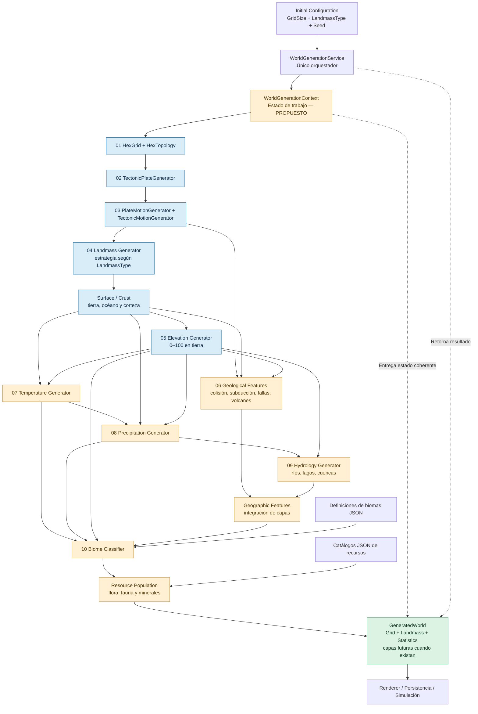
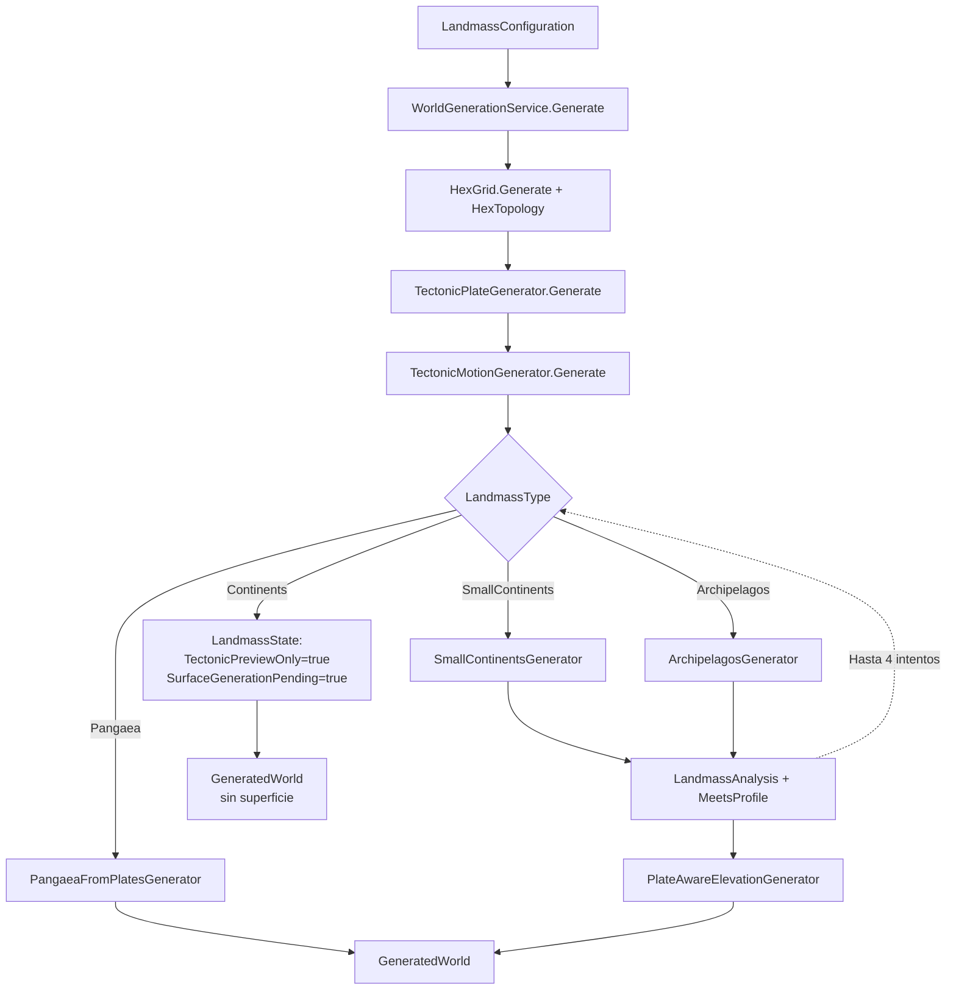
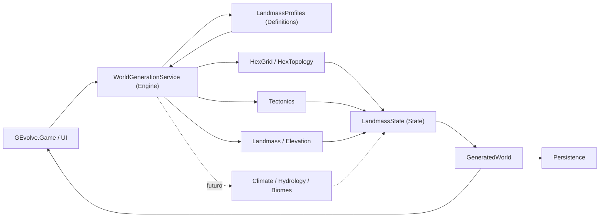
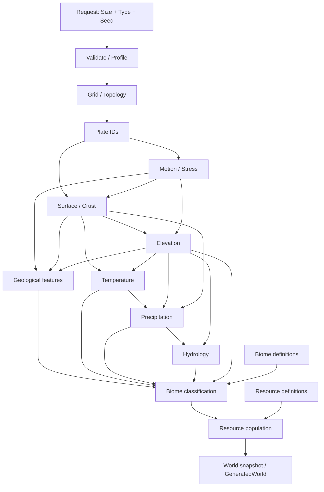

# Evolve — Arquitectura técnica de generación mundial

> **Rama de referencia:** `worldgenerator` (desarrollo) · **Base estable:** `master` · **Estado:** diseño objetivo + contrato vigente en `worldgenerator`.
> **Alcance:** motor `GEvolve.Engine`. Este documento NO afirma que las etapas planificadas estén implementadas.

## Alcance autorizado P03-A.6 — 6 de noviembre de 2026

**Actualización P03-A.7.1–7.2, 7 de noviembre:** [motor por etapas](PANGAEA_STAGED_GENERATION.md) temporal en Engine, creado por el orquestador oficial y compartido con el automático. Las separaciones superficie/BASE y sistemas/FINAL conservan todos los resultados P03-A.6. Los estados parciales son snapshots propios del laboratorio, fuera de State y de los guardados; solo un mundo completo se exporta mediante el contrato previo. La [interfaz manual de Game](../GEvolve.Game/PANGAEA_LABORATORY.md) consume capas opcionales en el renderer existente sin fabricar LandmassState, copia snapshots fuera del hilo gráfico y publica por revisión. Está implementada y pendiente de aprobación visual exclusiva del usuario; comparación visible avanzada y auditoría integral quedan en P03-A.7.3–7.4.

La calibración detallada en [PANGAEA_ROADMAP.md](PANGAEA_ROADMAP.md) modifica exclusivamente la composición vertical de las cordilleras existentes de Pangea. Conserva BASE P03-A.4, superficie, topología, placas/H04 y toda la geometría e influencia de los sistemas. No altera otros generadores ni introduce contratos persistibles nuevos. Engine calcula la envolvente y expone comparaciones temporales; State conserva los datos finales con el esquema previo; Game consume las mismas vistas sin cambios de representación. Los saves no se recalculan. Esta autorización acota la excepción de elevación a la prioridad de conservación descrita abajo; no implica aprobación visual de P03-A ni ejecución de P03-A.7.

**Ajuste P03-A.7.2.1:** Game inicia cuadrícula y agrupa la acción de placas→H04 usando las siete operaciones oficiales existentes; no cambia Engine. El laboratorio incorpora aleatoriedad de sesión independiente del RNG geográfico y anotaciones numéricas de campos vigentes. Únicamente su vista SUPERFICIE aplica blanco a tierra >90, con prioridad FINAL→BASE; no se modifica la paleta global, el estado persistible ni el valor de altura. La aprobación visual corresponde exclusivamente al usuario. Véase la [guía](../GEvolve.Game/PANGAEA_LABORATORY.md).

**Rediseño lateral posterior:** Game impone un flujo manual secuencial de cinco acciones sobre el DAG original de Engine. El tipo fijo Pangea, configuración, vistas, etapas e inspección se alojan en una columna; la cámara/renderer reciben el origen real del mapa a su derecha. Las alturas se anotan siempre cuando existen, con densidad según zoom. Cambiar configuración limpia datos y selección; el dado reinicia sin confirmación. Ninguna regla de precedencia de la UI altera las dependencias o los cálculos del generador. La validación técnica no certifica apariencia ni ejecuta el juego.

## Decisión de limpieza H05 — 5 de noviembre de 2026


**H05 experimental retirado del árbol operativo.** Se preservan en el historial Git los hitos H05-A1/A2, B1/B2/B3, la comparación regional A/B y la formación multiescala C1. La referencia de respaldo `backup/worldgenerator-pre-h05-cleanup-20261105` conserva el estado inmediatamente anterior a esta limpieza, sin reescribir historial.

**Prioridad vigente: Pangea.** Se conserva exactamente la implementación actual de `PangaeaFromPlatesGenerator`, su geometría, relieve, elevaciones y contratos de las etapas posteriores. Los cuatro tamaños, la cuadrícula flat-top, el seam horizontal E/O, las 16 placas y sus movimientos, contactos y esfuerzos H01–H04 se mantienen. Temperatura, precipitaciones, humedad, pendientes, biomas y recursos siguen perteneciendo a las capas compartidas, desarrollables de manera incremental a partir de Pangea.

`Continents` vuelve a `SurfaceGenerationPending`, con tectónica disponible pero sin corteza o superficie experimental. `Archipelagos` y `SmallContinents` mantienen su compatibilidad histórica; no se modifican sus generadores. Se conserva la selección de tres tipos principales; `SmallContinents` permanece histórico. Se han retirado los contratos corticales H05, los endpoints de comparación de superficies, las vistas A/B/C y el código experimental PCG y sus pruebas. `ContinentalGeologyState` anterior a H05 no es el contrato `SharedCorticalState` eliminado.

**Compatibilidad:** saves de mundos históricos sin `SharedCortex` conservan su ruta de carga. Las partidas experimentales H05 con superficie preliminar o datos `SharedCortex` requieren revisión/migración explícita antes de utilizarlas; no se promete compatibilidad con snapshots de desarrollo retirados. La validación del estado final y los baselines corresponde al usuario: no se ejecutan compilaciones ni pruebas en esta limpieza.

## 1. Objetivo y responsabilidades

`WorldGenerationService` es el **único orquestador** para obtener un `GeneratedWorld`. Los inputs obligatorios son tamaño (`GridSize`) y tipo de mundo (`LandmassType`); se admite una semilla (`int`) opcional para reproducibilidad.

- **Engine:** construye y calcula todas las capas del mundo mediante algoritmos deterministas.
- **Definitions:** define configuraciones, enumeraciones y perfiles.
- **State:** representa las capas y sus datos persistibles.
- **Game / renderer:** selecciona opciones, invoca al Engine y muestra el resultado. No calcula tectónica, clima ni biomas.
- **Catálogos JSON:** aportan definiciones de biomas y recursos; no reemplazan las simulaciones físicas.

**Regla:** el orquestador coordina etapas, dependencias, validación y resultado; la matemática y los algoritmos pertenecen a generadores especializados.

## 2. API vigente

Los tipos `GridSize`, `LandmassType`, `LandmassConfiguration`, `LandmassProfiles` y `GeneratedWorld` están presentes en `worldgenerator`.

```csharp
public GeneratedWorld Generate(GridSize size, LandmassType worldType, int seed = 2026)
    => Generate(LandmassProfiles.Create(size, worldType, seed));
```

**H01-A aprobado:** esta sobrecarga delega en `Generate(LandmassConfiguration)`, que valida el perfil oficial y coordina las etapas existentes.

La salida existente es:

```csharp
public sealed record GeneratedWorld(
    HexGrid Grid,
    LandmassState Landmass,
    LandmassStatistics? Statistics);
```

En el futuro puede añadirse una discriminación formal `Complete / Partial / Preview / Failed`, sin ocultar el estado incompleto de algunos tipos. No debe devolverse un mapa ficticiamente completo.

## 3. Diagrama principal — arquitectura objetivo



**Interpretación:** las flechas describen dependencia de datos y orden lógico, no necesariamente una única llamada lineal. Geología y clima consumen varias capas previas. `WorldGenerationContext` es un patrón sugerido y **no debe duplicar** innecesariamente `LandmassState`. Las fases climáticas y de biomas aparecen como objetivo de integración en el pipeline universal; hay implementaciones previas separadas.

## 4. Diagrama del código vigente en `worldgenerator`



### Hallazgos confirmados

1. En `WorldGenerationService` el orden actual es **grid → placas → movimiento → superficie/elevación según tipo**.
2. `TectonicPlateGenerator` genera **16 placas**, universales respecto al tipo de mundo para el mismo tamaño y semilla. La partición se realiza mediante crecimiento conectado ponderado en un grafo hexagonal, con ruido multiescala periódico horizontalmente.
3. `TectonicMotionGenerator` proyecta velocidades relativas sobre normal y tangente y calcula convergencia, divergencia y cizalla; propaga esfuerzos mediante una envolvente gaussiana.
4. `Pangaea`, `SmallContinents` y `Archipelagos` tienen rutas implementadas para superficie/elevación y validaciones morfológicas.
5. **`Continents` no genera superficie en ese servicio**; devuelve preview de tectónica con `SurfaceGenerationPending`. Nunca confundir sus ceros con océanos reales.
6. `ContinentalReliefGenerator` contiene lógica geológica avanzada, pero la presencia del archivo no equivale a estar integrado en la ruta principal.
7. `LandmassGenerationService` y su generador Pangaea anterior fueron retirados. `WorldGenerationService` no ejecuta todavía temperatura, precipitación ni clasificación de biomas; las pruebas ambientales componen esos generadores especializados explícitamente.
8. `SmallContinentsGenerator` y `ArchipelagosGenerator` implementan `IPlateAwareLandmassGenerator` y exigen placas universales válidas. Se retiraron `ILandmassGenerator` y las sobrecargas de superficie sin placas.
9. No se afirma que exista un sistema universal de ríos, lagos y cuencas conectado actualmente.

## 5. Dependencias y contratos de datos

| Etapa | Entradas mínimas | Salidas lógicas | Estado en `worldgenerator` |
|---|---|---|---|
| Grid/topología | Tamaño | Celdas, vecinos, índices, wrap horizontal | Implementado |
| Placas | Grid, seed | `PlateByCellId` | Implementado |
| Movimiento | Placas, topología, seed | Velocidades, interacciones, campos de esfuerzo | Implementado |
| Masas terrestres | Tipo, placas, configuración | `SurfaceByCellId` | Parcial por tipo |
| Elevación | Superficie, placas, configuración | `ElevationByCellId` | Implementado para rutas específicas |
| Geología | Corteza, movimiento, superficie y relieve | Cinturones, volcanes, fallas, fosas | Código existente; integración parcial |
| Temperatura | Latitud, superficie, altura | Temperatura por celda | Implementación anterior; integración universal pendiente |
| Precipitación | Temperatura, masas terrestres, elevación | Lluvia/humedad por celda | Implementación anterior; integración universal pendiente |
| Hidrología | Elevación, precipitaciones, vecinos | Ríos, lagos, drenajes | Planificado como etapa universal |
| Clasificación de biomas | Temperatura, precipitación, altitud, geografía | Tipo de bioma por celda | Implementación anterior; integración universal pendiente |
| Población de recursos | Bioma + catálogos y reglas de aparición | Flora, fauna, minerales posibles | Diseño objetivo; sin asumir integración |

### Invariantes

- Los arrays por celda usan **el mismo `CellId` y longitud `topology.Count`**.
- Los generadores de superficie de continentes pequeños y archipiélagos rechazan placas vacías, longitudes distintas de `topology.Count` e IDs fuera de `0..15`.
- Una semilla y configuración equivalentes deben producir resultados equivalentes.
- La envoltura es **este-oeste**, no norte-sur; no es una superficie esférica.
- Las placas no son continentes: una placa puede contener litosfera continental y oceánica.
- Los tipos de mundo reutilizan el generador tectónico; el tipo selecciona la estrategia de distribución de superficie.
- El océano no se deduce de valores por defecto durante una preview sin superficie.
- Los niveles `0–100` de elevación son índices del juego, no metros geofísicos.
- Cada etapa debe recibir entradas válidas y señalar explícitamente las dependencias no disponibles.
- Los catálogos definen contenido; no calculan tectónica, temperatura o erosión.

## 6. Estrategia de orquestación

**Principio:** un solo servicio público; generadores puros o especializados en Engine. Se conserva la posibilidad de regenerar con semilla y de inspeccionar resultados intermedios para depuración. La secuencia interna debería seguir este esquema:

```text
Validate request & select official LandmassProfiles
-> HexGrid / HexTopology
-> Tectonic plates
-> Tectonic motion and boundary interactions
-> Landmass strategy by world type
-> Validate surface profile (retry deterministically if supported)
-> Elevation and geological features
-> Temperature
-> Precipitation
-> Hydrology
-> Biome classification
-> Resource population from definitions
-> Validate and return GeneratedWorld
```

No se debe activar una fase futura sin verificar la existencia y compatibilidad de sus datos predecesores. No debe ejecutarse dos veces una generación de placas por cambiar de tipo si tamaño y semilla no cambian. Para comparaciones, la secuencia de RNG de cada subsistema debe estar aislada.

### Propuesta: contexto de trabajo

Un posible `WorldGenerationContext` interno puede transportar `HexGrid`, `HexTopology` y resultados de etapas, pero **no está implementado en este documento**. Antes de introducirlo, evaluar si `LandmassState` actual basta y evitar representaciones duplicadas y mutables. La salida pública seguirá siendo `GeneratedWorld`.

## 7. Organización y puntos de integración

```text
GEvolve.Engine/
  World/
    WorldGenerationService.cs                 <-- único orquestador
    Tectonics/
      TectonicPlateGenerator.cs
      PlateMotionGenerator.cs
      TectonicMotionGenerator.cs
    LandmassGeneration/
      IPlateAwareLandmassGenerator.cs         <-- contrato de superficie con placas
      PlateSurfaceInfluence.cs                <-- validación y guía tectónica
      PangaeaFromPlatesGenerator.cs
      SmallContinentsGenerator.cs
      ArchipelagosGenerator.cs
      PlateAwareElevationGenerator.cs
      ContinentalReliefGenerator.cs
      LandmassAnalysis.cs
    Climate/                                  <-- implementación existente a auditar
    BiomeGeneration/                          <-- implementación existente a auditar
GEvolve.Definitions/
  WorldGeneration/Configuration/
    LandmassConfiguration.cs                  <-- enums, perfiles y configuración
GEvolve.State/
  .../LandmassState.cs                        <-- capas existentes
```

Las rutas anteriores son una **guía lógica** basada en archivos conocidos; revisar las ubicaciones reales de las clases antes de refactorizar. `HexGrid` pertenece a `GEvolve.Engine.Grid`; no asumir que reside físicamente bajo `World/`.

## 8. Roadmap incremental

### Fase 1 — Entrada única (sin modificar algoritmos)
- [x] Añadir la sobrecarga pública `Generate(GridSize, LandmassType, int seed = 2026)` (implementada y validada en `worldgenerator`).
- [x] Construir configuración con `LandmassProfiles.Create` y reutilizar la implementación existente.
- [ ] Documentar salida completa vs. preview pendiente y las excepciones.
- [ ] Confirmar todos los sitios de invocación desde Game y servicios.

**Aceptación:** el consumidor puede pedir cualquier tipo/tamaño mediante una sola API, sin perder información sobre generaciones pendientes.

### Fase 2 — Consolidar orquestación
- [x] Retirar `LandmassGenerationService` y migrar sus consumidores a `WorldGenerationService`.
- [x] Elegir `WorldGenerationService` como ruta canónica sin romper guardados ni previews.
- [ ] Mantener los generadores especializados fuera del orquestador.
- [ ] Definir contrato de resultados parciales y reglas de validación.

**Aceptación:** ningún consumidor debe elegir manualmente un pipeline alternativo.

### Fase 3 — Unificar superficie y relieve
- [ ] Integrar cada estrategia de mundo bajo el mismo contrato.
- [ ] Terminar la superficie de `Continents` antes de declararla lista.
- [ ] Conectar los accidentes tectónicos a su origen físico si los datos están disponibles.
- [ ] Validar conectividad, continuidad este-oeste y rango de alturas.

**Aceptación:** los cuatro tipos generan capas coherentes y trazables.

### Fase 4 — Clima compartido
- [ ] Revisar `TemperatureGenerator` y `PrecipitationGenerator` existentes.
- [ ] Integrarlos solo después de superficie y elevación.
- [ ] Evitar ciclos en las dependencias.
- [ ] Comprobar determinismo y continuidad climática.

### Fase 5 — Hidrología, biomas y recursos
- [ ] Diseñar drenaje sobre grafo hexagonal, cuencas, ríos y lagos.
- [ ] Clasificar biomas con clima, altitud y condiciones geográficas.
- [ ] Integrar catálogos JSON por reglas y referencias de identificadores.
- [ ] Distinguir disponibilidad potencial de recursos y su colocación efectiva.

### Fase 6 — Calidad y mantenimiento
- [ ] Verificar equivalencia para misma configuración y semilla.
- [ ] Ejecutar escenarios para todos los `GridSize` / `LandmassType`.
- [ ] Validar tamaños de arrays, IDs, wrap, integridad de estado parcial.
- [ ] Perfilar memoria, tiempo y asignaciones por fase.
- [ ] Documentar versiones algorítmicas y consecuencias para partidas guardadas.

## 9. Decisiones de diseño

1. **Sí**: todos los cálculos del mundo se orquestan desde **Engine**.
2. **No**: el renderer no genera placas, alturas, clima o biomas.
3. **Sí**: placas tectónicas universales para todos los tipos, sin confundir placas con continentes.
4. **Sí**: definición de recursos a partir de catálogos, separada de la física del terreno.
5. **No**: fingir que una etapa planificada ya existe o que un preview equivale a un mundo terminado.
6. **No**: implementar nuevos algoritmos solo por añadir el orquestador.

## 10. Referencias del código vigente

- `GEvolve.Engine/World/WorldGenerationService.cs`
- `GEvolve.Engine/World/Tectonics/TectonicPlateGenerator.cs`
- `GEvolve.Engine/World/Tectonics/PlateMotionGenerator.cs`
- `GEvolve.Engine/World/Tectonics/TectonicMotionGenerator.cs`
- `GEvolve.Engine/World/LandmassGeneration/IPlateAwareLandmassGenerator.cs`
- `GEvolve.Engine/World/LandmassGeneration/PlateSurfaceInfluence.cs`
- `GEvolve.Engine/World/LandmassGeneration/ContinentalReliefGenerator.cs`
- `GEvolve.Definitions/WorldGeneration/Configuration/LandmassConfiguration.cs`

**Nota de alcance:** el contrato actual exige placas para los generadores de superficie de continentes pequeños y archipiélagos; las fases futuras del diagrama principal siguen siendo propuestas.


---

# Anexo de especificación de ingeniería (v1)

> **Convención de trazabilidad:** [ACTUAL] significa observado en código de `worldgenerator`; [OBJETIVO] es una decisión de diseño aún no implementada; [RIESGO] indica comportamiento que requiere verificación en ejecución. Esta sección no constituye una declaración de conformidad del motor.

## A. Límites arquitectónicos y aislamiento de responsabilidades



**Dependencias permitidas [OBJETIVO]:** las fases pueden depender de tipos de `Definitions`, geometría y outputs previos, pero no de `GEvolve.Game` ni del renderer. `State` no debería tener dependencia de gráficos. El orquestador no debe almacenar estado global mutable compartido entre ejecuciones.

**Ownership:** cada módulo debe declarar los campos que produce. Una etapa posterior no reescribe una capa anterior sin una regla explícita (por ejemplo, emergencia volcánica que cambia superficie); cualquier mutación debe volver a validar invariantes derivadas y estadísticas.

## B. Grafo de dependencias de datos (DAG)

La secuencia **no es solo una cadena**: una fase puede necesitar varias capas. Cada arista se interpreta como requisito previo, no como una llamada obligatoriamente sincrónica.



**Política de prerequisitos [OBJETIVO]:** las fases deben declarar entradas obligatorias. Si faltan capas, o se devuelve un estado parcial explícito o se lanza un error tipado; no completar arrays con ceros indistinguibles de datos reales.

## C. Contratos de API y compatibilidad

### C.1 Contrato actual

- [ACTUAL] `WorldGenerationService.Generate(LandmassConfiguration)` valida la igualdad contra `LandmassProfiles.Create(size,type,seed)`.
- [ACTUAL] `GeneratePlatePreview(LandmassConfiguration)` devuelve un estado de visualización tectónica.
- [ACTUAL] `GeneratedWorld(HexGrid Grid, LandmassState Landmass, LandmassStatistics? Statistics)`.
- [ACTUAL] `LandmassType`: `Continents`, `Pangaea`, `SmallContinents`, `Archipelagos`.
- [ACTUAL] `LandmassProfiles.CurrentGeneratorVersion = "landmass-12"` en el archivo de configuración consultado.

### C.2 Fachada implementada

```csharp
public GeneratedWorld Generate(GridSize size, LandmassType type, int seed = 2026)
{
    var configuration = LandmassProfiles.Create(size, type, seed);
    return Generate(configuration);
}
```

**H01-A aprobado:** la sobrecarga delega a la existente y la matriz de validación pasó en .NET 10.

### C.2.1 Contrato de superficie con placas

```csharp
public interface IPlateAwareLandmassGenerator
{
    LandmassType Type { get; }
    byte[] Generate(HexTopology topology, LandmassConfiguration configuration,
        int attempt, ReadOnlySpan<byte> plates);
}
```

`SmallContinentsGenerator` y `ArchipelagosGenerator` solo exponen esta firma. `PlateSurfaceInfluence` exige un arreglo de longitud `topology.Count` cuyos IDs sean menores que `TectonicPlateGenerator.NumberOfPlates` (16); los arreglos vacíos, cortos, largos o con IDs inválidos producen `ArgumentException` para `plates`. El orquestador produce y entrega esas placas antes de generar superficie. `PangaeaFromPlatesGenerator` conserva su firma especializada con placas y elevación. No existe `ILandmassGenerator`.

**No introducir `WorldGenerationRequest` como clase obligatoria en la primera fase**: con los tipos existentes, la firma basta. Si se incorporan decenas de parámetros independientes, evaluar un DTO inmutable más adelante.

### C.3 Estados del resultado

| Estado semántico | Significado | Condición exigida |
|---|---|---|
| Complete [OBJETIVO] | Todas las capas habilitadas por el pipeline están materializadas | Arrays válidos y dependencias satisfechas |
| Partial [OBJETIVO] | Generación deliberadamente incompleta | Razón explícita y campos disponibles |
| Preview [ACTUAL] | Inspección de placas/movimiento sin superficie real | `TectonicPreviewOnly` |
| Pending [ACTUAL] | Tipo `Continents` aún sin superficie en `WorldGenerationService` | `SurfaceGenerationPending` |
| Failed [OBJETIVO] | No se pudo satisfacer el contrato | Excepción/error; no confundir con mapa vacío |

**Precisión:** la tabla de estados es conceptual; no existe una enumeración con esos nombres en `worldgenerator`.

### C.4 Semántica de los datos

`PlateByCellId` es un ID de placa, `SurfaceByCellId` representa ocupación tierra/océano, `ElevationByCellId` representa niveles del juego. Todos deben indexarse por `CellId`. No interpretar `Elevation=0` sin consultar el tipo de superficie y la validez de la fase. No asumir que IDs de bioma o de recursos pueden representarse siempre en `byte`: validar cardinalidad y el contrato del catálogo.

## D. Detalle algorítmico: topología

### D.1 Indexación y vecindad

- [ACTUAL] Espacio hexagonal discretizado y envuelto horizontalmente.
- [ACTUAL] `CellId = fila × columnas + columna`, consecutivo de `0` a `N−1`; `HexGrid` y `HexTopology` conservan la misma vecindad.
- [ACTUAL] Cada celda tiene como máximo seis vecinos únicos y simétricos; la costura E/O se conecta y los bordes norte/sur permanecen abiertos.
- [ACTUAL] `HexTopology.Id` envuelve columnas, pero rechaza filas fuera de rango. `Neighbors` y `Distance` rechazan IDs fuera de `0..N−1` con `ArgumentOutOfRangeException`. `HexGrid.TryGet` conserva su consulta sin envolvimiento.

**Tres proporciones distintas:** `Columns/Rows` es la proporción lógica de la matriz y se aproxima a `3:2` (200/133, 250/167, 300/200, 400/267). Un hexágono flat-top de radio `r` tiene ancho `2r` y alto `√3r`, proporción `2/√3 ≈ 1,155`, que no define la proporción del mapa. El periodo horizontal físico es `1,5 × Columns × r` y la altura física es `√3 × (Rows + 0,5) × r`; su cociente ronda `1,29–1,30` en los tamaños oficiales. `MapCamera2D` aplica una escala uniforme en X/Y, por lo que esta proporción se conserva al mostrar el mapa completo; el recorte, zoom y tamaño de ventana cambian el área visible, no la geometría ni la topología.

Para una cuadrícula de `W × H` celdas, la ocupación base de un array `byte[N]` es aproximadamente `N` bytes, con `N=W×H`, sin incluir encabezados del objeto, estructuras auxiliares ni referencias. Un array `float[N]` necesita aproximadamente `4N` bytes. Son estimaciones teóricas, no mediciones del profiler.

### D.2 Invariantes verificables

```text
N = grid.CellCount
PlateByCellId.Length == N
HasSurface => SurfaceByCellId.Length == N
HasElevation => ElevationByCellId.Length == N
0 <= CellId < N
IDs de placa válidos para la versión del algoritmo
No hay celdas con placa sin asignar
Conectividad E/O preservada
```

No imponer arrays completos a los estados preview que explícitamente no disponen de superficie.

**Validación H02:** `GridTests` recorre todas las celdas y enlaces de los cuatro tamaños, compara `HexGrid.Distance` y `HexTopology.Distance` con BFS sobre vecinos reales desde diez orígenes deterministas por tamaño (150 pares por tamaño) y mide por separado tiempo, bytes asignados y colecciones GC durante la construcción de Enormous. La diferencia de memoria retenida tras GC forzado es una observación separada de los bytes asignados; no hay umbrales de tiempo dependientes del hardware.

## E. Detalle algorítmico: placas y movimiento

### E.1 Partición tectónica [ACTUAL]

`TectonicPlateGenerator` emplea exactamente 16 placas (`NumberOfPlates = 16`), selecciona semillas espacialmente separadas, baraja costes de expansión y crece regiones mediante `PriorityQueue`. La resistencia del terreno combina ruido periódico multibanda, con `domain warping`, y cada placa usa combinaciones distintas de los campos. El coste acumulado de crecimiento puede modelarse como:

```text
cost(next, plate) = cost(current, plate) + baseCost[plate] * resistance(next, plate)
resistance = clamp(1 - irregularity * noiseMix, minResistance, maxResistance)
```

Una celda es reclamada desde una celda conectada; no se asignan etiquetas de placa mediante umbrales independientes. `TectonicPlateTests` verifica con BFS sobre `HexTopology` que cada ID de 0 a 15 forma una única región, sin celdas vacías, para los cuatro tamaños y las semillas 2026, 42 y -731. Compara el arreglo completo entre Pangaea, SmallContinents, Archipelagos y Continents, y repite la preview de cada tamaño y semilla para comprobar determinismo. Las tres semillas producen particiones distintas en cada tamaño. `Continents` conserva su superficie pendiente.

`PlateBoundaryMap` representa cada frontera como una arista canónica entre vecinos reales con IDs distintos. Las pruebas contrastan todas las aristas esperadas con las emitidas, sin duplicados, comprueban las interacciones de la costura E/O y repiten el análisis para verificar determinismo. Ninguna regla exige que una frontera coincida con costas, montañas o continentes: el ID tectónico no clasifica superficie ni corteza.

### E.2 Cinemática y deformación [ACTUAL]

```text
velocity(plate) = speed * (cos(theta), sin(theta))
relativeVelocity(A,B) = velocity(B) - velocity(A)
normalComponent = dot(relativeVelocity, edgeNormal)
shearComponent = abs(dot(relativeVelocity, edgeTangent))
convergence = max(0, -normalComponent)
divergence = max(0, normalComponent)
```

Las categorías de interacción incluyen convergencia, divergencia, transformante, mixta y quieta según umbrales. Los campos de influencia se propagan con kernel `exp(-(distance/radius)^2)`, usando máximo por canal para no multiplicar artificialmente la intensidad por densidad de bordes.

**Limitación física declarada:** modelo cinemático 2D; no resuelve flexión de placas, geodinámica térmica, reología ni evolución temporal continua. La velocidad está expresada en cm/año, pero no implica que la grid use una resolución espacial en km calibrada.

## F. Detalle: masas terrestres, relieve y accidentes

### F.1 Selección de estrategia [ACTUAL]

```text
Pangaea          -> PangaeaFromPlatesGenerator
SmallContinents  -> SmallContinentsGenerator + PlateAwareElevationGenerator
Archipelagos     -> ArchipelagosGenerator + PlateAwareElevationGenerator
Continents       -> Preview tectónica, sin superficie en el servicio publicado
```

El servicio repite como máximo cuatro intentos de generación y usa `LandmassAnalysis` / `MeetsProfile` para validar propiedades morfológicas. **No interpretar estos criterios como una garantía de realismo tectónico**. Revisar que la validación de perfil ocurre después de las operaciones que puedan cambiar superficie.

Los dos generadores de superficie no continental reciben las placas universales mediante `IPlateAwareLandmassGenerator`; no conservan sobrecargas de generación sin placas. La guía de `PlateSurfaceInfluence` valida longitud e IDs antes de construir la superficie, sin alterar las placas recibidas.

### F.2 Geología

[ACTUAL] `ContinentalReliefGenerator` clasifica contactos (colisión continental, rift, dorsales, transformante, subducción oceánica/continental), crea campos de deformación y propone volcanes sobre la placa superior con desplazamiento respecto a la fosa. También calcula profundidad oceánica. [RIESGO] No está conectado a la ruta `Continents` del `WorldGenerationService` publicado: una clase presente no es una etapa ejecutada.

**Reglas [OBJETIVO]:**
1. El tipo de corteza no equivale al identificador de placa.
2. El levantamiento orogénico debe derivarse de contactos y deformación, no de ruido aislado.
3. Las fallas, rifts, dorsales y arcos volcánicos deberían conservar procedencia geológica.
4. Toda alteración tardía de superficie (por volcanismo u otros eventos) obliga a recalcular o invalidar estadísticas y datos derivados.
5. La escala `0–100` es una cuantización de juego; documentar explícitamente una función de conversión antes de usar metros o km.

## G. Diseño climático, hidrológico y ecológico [OBJETIVO]

### G.1 Temperatura

Una formulación futura de referencia, **no implementada aquí**, puede ser:

```text
T(cell) = latitudeBaseline(latitude)
        - lapseRate * altitudeKm
        + continentalityCorrection
        + regionalNoise
```

Se requieren escala vertical física, definición de latitud y estacionalidad antes de calibrar parámetros. Una latitud inferida linealmente de filas es aproximación sobre la topología cilíndrica.

### G.2 Precipitación

La precipitación debe depender de advección de humedad, proximidad a océanos, vientos y orografía. Modelar explícitamente barlovento/sotavento si se quiere sombra pluviométrica. No basta con colorear ruido independiente por celda. La normalización debe preservar variación climática entre tamaños.

### G.3 Hidrología

**Orden recomendado:** elevación + precipitación → dirección de flujo → tratamiento de sumideros → acumulación → selección de canales → cuencas → lagos / desembocaduras. En topología hexagonal cada celda terrestre tiene hasta seis receptores candidatos; definir desempate determinista en pendientes iguales. Usar grafos y evitar ciclos de drenaje. Decidir explícitamente si los lagos endorreicos están permitidos.

Los ríos y lagos pertenecen a hidrología; las cordilleras, fosas, fallas y volcanes a geología. Una capa de `GeographicFeatures` puede reunirlos para renderizado sin borrar su procedencia.

### G.4 Biomas y recursos

`BiomeClassifier` debe consumir temperatura, precipitación, elevación y rasgos físicos, con reglas ordenadas y deterministas. La clasificación ecológica es distinta de la población de flora/fauna/minerales. Los catálogos JSON definen elegibilidad, identificadores, biomas compatibles y reglas de aparición. Las posiciones efectivas de recursos deben proceder de un generador separado y reproducible. Considerar **geología para minerales**, no limitar todos los recursos a etiquetas de bioma.

### G.5 Evitar ciclos de dependencias

El DAG inicial es acíclico. Si se introduce retroalimentación (erosión fluvial que altera elevación, cambios de costa que afectan precipitación), definir un **solver iterativo explícito**, con orden, número de iteraciones, criterio de convergencia y versionado; no crear dependencias circulares implícitas en el orquestador.

## H. Determinismo y versionado

- [OBJETIVO] Igual configuración + mismo algoritmo/versiones de catálogos => mismo resultado byte a byte en el entorno de referencia.
- [ACTUAL] Generadores tectónicos usan streams deterministas separados; mantener independencia por dominio.
- [OBJETIVO] Evitar consumir el RNG de una etapa en otra; usar `seed` + salt estable por etapa + índice de intento.
- [OBJETIVO] Fijar orden de iteración, desempates y ordenamientos estables; no depender del orden de enumeración de contenedores no ordenados.
- [RIESGO] Diferencias de `float/double`, arquitectura o cambios del runtime pueden afectar igualdad binaria entre plataformas; ejecutar fixtures comparativos reales antes de prometer cross-platform determinism.
- [OBJETIVO] Registrar versiones de generadores y esquemas en metadatos de partidas. Cambios algorítmicos pueden regenerar mapas diferentes pese a conservar la semilla.

## I. Rendimiento y complejidad

Sea `N` el número de celdas, `E` el número de aristas hexagonales y `P` las placas.

| Subsistema | Característica | Punto de vigilancia |
|---|---|---|
| Grid | O(N) memoria base | Representación de vecinos / asignaciones |
| Crecimiento de placas | Cola de prioridad sobre candidatos del grafo | Número de encolados, `O(log Q)` por operación |
| Análisis de componentes | BFS/DFS cercano a O(N+E) | Repetición por intento |
| Movimiento | Interacciones en bordes + propagación espacial | Radio y límite de difusión; coste puede dominar |
| Elevación/clima | Barridos por celda, normalmente O(N) por fase | Ruido multibanda y conversiones |
| Hidrología [OBJETIVO] | Drenaje / acumulación sobre grafo | Ordenación, depresiones y ausencia de ciclos |
| Recursos [OBJETIVO] | Reglas por celda y catálogo | Índices por bioma y geología |

Estas expresiones describen operaciones; **no son benchmarks medidos**. Instrumentar por fase: duración, bytes asignados, GC, tamaño de arrays, número de intentos, cobertura de datos, métricas geográficas y huella por semilla. Medir con tamaños reales de `HexGridDefinitions`.

## J. Validación, pruebas de contrato y observabilidad

### J.1 Matriz mínima de escenarios

| Dimensión | Cobertura |
|---|---|
| Tipo | Todos los valores de `LandmassType` |
| Tamaño | Todos los valores de `GridSize` |
| Semilla | Fija, alternativa, casos extremos documentados |
| Estado | Completo, preview, pendiente, error de perfil |
| Geografía | Costura horizontal, límites N/S, conectividad de placas y continentes |
| Datos | Rango de IDs, arrays alineados, finite values, alturas/superficie coherentes |
| Repetición | Comparación de hashes / snapshots deterministas |

**En línea con el criterio del proyecto:** no es necesario crear una carpeta `TEST` o volver a adoptar un laboratorio de generación anterior. Las comprobaciones de contrato se pueden integrar en la infraestructura de pruebas elegida para el repositorio y en validadores de Engine sin introducir directorios temporales.

### J.2 Resultado diagnóstico [OBJETIVO]

Registrar como mínimo:

```text
WorldSize, WorldType, Seed, GeneratorVersion,
PlateCount, LandCellCount, OceanCellCount,
ComponentCount, DominantLandShare,
ChosenAttempt, SurfaceAvailable, ElevationAvailable,
PerStageDuration, AllocatedBytes, FailureReason
```

No tratar los diagnostics como parte del algoritmo aleatorio. El pipeline debe exponer claramente qué etapa no pudo completarse y por qué.

## K. Migración y criterios de aceptación

### K.1 Migración segura

1. Inventariar consumidores de `WorldGenerationService` y previews; el servicio legacy fue retirado en H01-B4.
2. Añadir sobrecarga pública con tamaño/tipo/semilla sin modificar el overload existente.
3. Actualizar consumidores gradualmente; H01-B7 retira el contrato de superficie sin placas.
4. Consolidar un único pipeline **solo cuando** la semántica de cada tipo y de las etapas climáticas esté verificada.
5. Eliminar duplicación tras asegurar compatibilidad de partidas, replays y herramientas.
6. Activar hidrología/recursos como nuevas fases únicamente con contratos y métricas.

### K.2 Definition of Done de la primera iteración

- [ ] La API expone `Generate(GridSize, LandmassType, int seed = 2026)`.
- [ ] El servicio construye configuración mediante `LandmassProfiles.Create`.
- [ ] Todos los tipos y tamaños válidos conservan el comportamiento actual.
- [ ] `Continents` conserva explícitamente su estado pendiente; no se presenta como mundo completo.
- [ ] Ningún generador cambia sus fórmulas por refactor de orquestación.
- [ ] Los consumidores no necesitan crear o seleccionar generadores internos.
- [ ] Se verifican resultados deterministas para semillas de referencia.
- [ ] El documento refleja cualquier cambio real de contrato.

## L. Registro de decisiones (ADR simplificado)

| ID | Decisión | Motivo | Estado |
|---|---|---|---|
| ADR-WG-001 | Un solo orquestador público | API estable / encapsulamiento | Propuesto |
| ADR-WG-002 | Placas universales antes de tipo de superficie | Coherencia geológica | Ya aplicado en servicio principal |
| ADR-WG-003 | Separar generación geológica e hidrológica | Diferentes dependencias y modelos físicos | Propuesto |
| ADR-WG-004 | Bioma ≠ población de recursos | Reglas independientes y extensibles | Propuesto |
| ADR-WG-005 | Resultados parciales explícitos | No fabricar mapas válidos desde previews | Parcialmente disponible |
| ADR-WG-006 | Mantener `GeneratedWorld` como contrato inicial | Reducir riesgo de migración | Propuesto |
| ADR-WG-007 | No duplicar `LandmassState` por adelantado | Evitar estados inconsistentes | Propuesto |
| ADR-WG-008 | Versionado de algoritmos y resultados | Reproducción y compatibilidad | Parcialmente disponible |

---

*Este anexo es documentación de ingeniería. No modifica algoritmos, clases ni archivos de código. Las hipótesis de futuras etapas deben convertirse en requisitos verificables antes de implementarse.*
