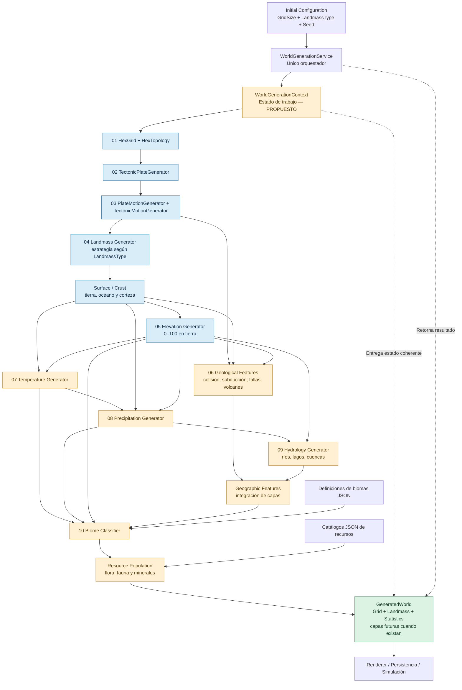
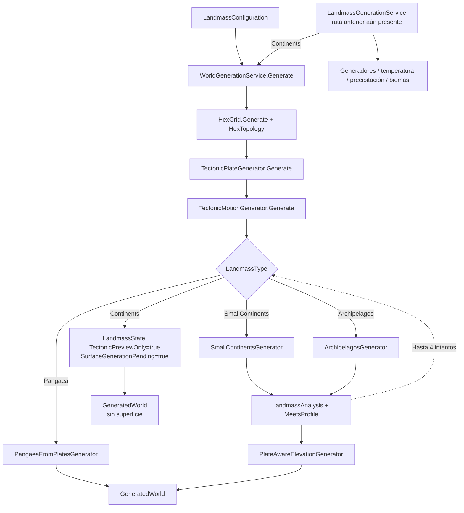

# Evolve — Arquitectura técnica de generación mundial

> **Rama de referencia:** `master` · **Estado:** diseño objetivo + inventario de la implementación actual.  
> **Alcance:** motor `GEvolve.Engine`. Este documento NO afirma que las etapas planificadas estén implementadas.

## 1. Objetivo y responsabilidades

`WorldGenerationService` será el **único punto de entrada público recomendado** para obtener un `GeneratedWorld`. Los inputs obligatorios son tamaño (`GridSize`) y tipo de mundo (`LandmassType`); se admite una semilla (`int`) opcional para reproducibilidad.

- **Engine:** construye y calcula todas las capas del mundo mediante algoritmos deterministas.
- **Definitions:** define configuraciones, enumeraciones y perfiles.
- **State:** representa las capas y sus datos persistibles.
- **Game / renderer:** selecciona opciones, invoca al Engine y muestra el resultado. No calcula tectónica, clima ni biomas.
- **Catálogos JSON:** aportan definiciones de biomas y recursos; no reemplazan las simulaciones físicas.

**Regla:** el orquestador coordina etapas, dependencias, validación y resultado; la matemática y los algoritmos pertenecen a generadores especializados.

## 2. API objetivo

Los tipos `GridSize`, `LandmassType`, `LandmassConfiguration`, `LandmassProfiles` y `GeneratedWorld` ya existen en `master`.

```csharp
public sealed class WorldGenerationService
{
    public GeneratedWorld Generate(
        GridSize size,
        LandmassType worldType,
        int seed = 2026)
    {
        var config = LandmassProfiles.Create(size, worldType, seed);
        return Generate(config);
    }

    // La implementación actual ya dispone del overload que recibe LandmassConfiguration.
    public GeneratedWorld Generate(LandmassConfiguration configuration)
    {
        // Orquestación: validar -> generar dependencias -> devolver resultado.
        // Este bloque es una firma conceptual, no código listo para sustituir.
        throw new NotImplementedException();
    }
}
```

**Importante:** la sobrecarga de tres parámetros es una **propuesta**, no una API existente verificada. No reemplazar el cuerpo actual de `Generate(LandmassConfiguration)` por el ejemplo.

La salida existente es:

```csharp
public sealed record GeneratedWorld(
    HexGrid Grid,
    LandmassState Landmass,
    LandmassStatistics? Statistics);
```

En el futuro puede añadirse una discriminación formal `Complete / Partial / Preview / Failed`, sin ocultar el estado incompleto de algunos tipos. No debe devolverse un mapa ficticiamente completo.

## 3. Diagrama principal — arquitectura objetivo



**Interpretación:** las flechas describen dependencia de datos y orden lógico, no necesariamente una única llamada lineal. Geología y clima consumen varias capas previas. `WorldGenerationContext` es un patrón sugerido y **no debe duplicar** innecesariamente `LandmassState`. Las fases climáticas y de biomas aparecen como objetivo de integración en el pipeline universal; hay implementaciones previas separadas.

## 4. Diagrama del código comprobado en master



### Hallazgos confirmados

1. En `WorldGenerationService` el orden actual es **grid → placas → movimiento → superficie/elevación según tipo**.
2. `TectonicPlateGenerator` de `master` genera **16 placas**, universales respecto al tipo de mundo para el mismo tamaño y semilla. La partición se realiza mediante crecimiento conectado ponderado en un grafo hexagonal, con ruido multiescala periódico horizontalmente.
3. `TectonicMotionGenerator` proyecta velocidades relativas sobre normal y tangente y calcula convergencia, divergencia y cizalla; propaga esfuerzos mediante una envolvente gaussiana.
4. `Pangaea`, `SmallContinents` y `Archipelagos` tienen rutas implementadas para superficie/elevación y validaciones morfológicas.
5. **`Continents` no genera superficie en ese servicio**; devuelve preview de tectónica con `SurfaceGenerationPending`. Nunca confundir sus ceros con océanos reales.
6. `ContinentalReliefGenerator` contiene lógica geológica avanzada, pero la presencia del archivo no equivale a estar integrado en la ruta principal.
7. Coexiste `LandmassGenerationService`, con una ruta anterior que aplica `TemperatureGenerator`, `PrecipitationGenerator` y `BiomeClassifier`. No asumir que esas etapas corren desde el `WorldGenerationService` principal.
8. No se afirma que exista un sistema universal de ríos, lagos y cuencas conectado actualmente.

## 5. Dependencias y contratos de datos

| Etapa | Entradas mínimas | Salidas lógicas | Estado respecto a master |
|---|---|---|---|
| Grid/topología | Tamaño | Celdas, vecinos, índices, wrap horizontal | Implementado |
| Placas | Grid, seed | `PlateByCellId` | Implementado |
| Movimiento | Placas, topología, seed | Velocidades, interacciones, campos de esfuerzo | Implementado |
| Masas terrestres | Tipo, placas, configuración | `SurfaceByCellId` | Parcial por tipo |
| Elevación | Superficie, placas, configuración | `ElevationByCellId` | Implementado para rutas específicas |
| Geología | Corteza, movimiento, superficie y relieve | Cinturones, volcanes, fallas, fosas | Código existente; integración parcial |
| Temperatura | Latitud, superficie, altura | Temperatura por celda | Implementación anterior; integración universal pendiente |
| Precipitación | Temperatura, masas terrestres, elevación | Lluvia/humedad por celda | Implementación anterior; integración universal pendiente |
| Hidrología | Elevación, precipitaciones, vecinos | Ríos, lagos, drenajes | Planificado como etapa universal |
| Clasificación de biomas | Temperatura, precipitación, altitud, geografía | Tipo de bioma por celda | Implementación anterior; integración universal pendiente |
| Población de recursos | Bioma + catálogos y reglas de aparición | Flora, fauna, minerales posibles | Diseño objetivo; sin asumir integración |

### Invariantes

- Los arrays por celda usan **el mismo `CellId` y longitud `topology.Count`**.
- Una semilla y configuración equivalentes deben producir resultados equivalentes.
- La envoltura es **este-oeste**, no norte-sur; no es una superficie esférica.
- Las placas no son continentes: una placa puede contener litosfera continental y oceánica.
- Los tipos de mundo reutilizan el generador tectónico; el tipo selecciona la estrategia de distribución de superficie.
- El océano no se deduce de valores por defecto durante una preview sin superficie.
- Los niveles `0–100` de elevación son índices del juego, no metros geofísicos.
- Cada etapa debe recibir entradas válidas y señalar explícitamente las dependencias no disponibles.
- Los catálogos definen contenido; no calculan tectónica, temperatura o erosión.

## 6. Estrategia de orquestación

**Principio:** un solo servicio público; generadores puros o especializados en Engine. Se conserva la posibilidad de regenerar con semilla y de inspeccionar resultados intermedios para depuración. La secuencia interna debería seguir este esquema:

```text
Validate request & select official LandmassProfiles
-> HexGrid / HexTopology
-> Tectonic plates
-> Tectonic motion and boundary interactions
-> Landmass strategy by world type
-> Validate surface profile (retry deterministically if supported)
-> Elevation and geological features
-> Temperature
-> Precipitation
-> Hydrology
-> Biome classification
-> Resource population from definitions
-> Validate and return GeneratedWorld
```

No se debe activar una fase futura sin verificar la existencia y compatibilidad de sus datos predecesores. No debe ejecutarse dos veces una generación de placas por cambiar de tipo si tamaño y semilla no cambian. Para comparaciones, la secuencia de RNG de cada subsistema debe estar aislada.

### Propuesta: contexto de trabajo

Un posible `WorldGenerationContext` interno puede transportar `HexGrid`, `HexTopology` y resultados de etapas, pero **no está implementado en este documento**. Antes de introducirlo, evaluar si `LandmassState` actual basta y evitar representaciones duplicadas y mutables. La salida pública seguirá siendo `GeneratedWorld`.

## 7. Organización y puntos de integración

```text
GEvolve.Engine/
  World/
    WorldGenerationService.cs                 <-- entrada principal actual; orquestador objetivo
    Tectonics/
      TectonicPlateGenerator.cs
      PlateMotionGenerator.cs
      TectonicMotionGenerator.cs
    LandmassGeneration/
      LandmassGenerationService.cs            <-- ruta anterior que debe revisarse
      PangaeaFromPlatesGenerator.cs
      SmallContinentsGenerator.cs
      ArchipelagosGenerator.cs
      PlateAwareElevationGenerator.cs
      ContinentalReliefGenerator.cs
      LandmassAnalysis.cs
    Climate/                                  <-- implementación existente a auditar
    BiomeGeneration/                          <-- implementación existente a auditar
GEvolve.Definitions/
  WorldGeneration/Configuration/
    LandmassConfiguration.cs                  <-- enums, perfiles y configuración
GEvolve.State/
  .../LandmassState.cs                        <-- capas existentes
```

Las rutas anteriores son una **guía lógica** basada en archivos conocidos; revisar las ubicaciones reales de las clases antes de refactorizar. `HexGrid` pertenece a `GEvolve.Engine.Grid`; no asumir que reside físicamente bajo `World/`.

## 8. Roadmap incremental

### Fase 1 — Entrada única (sin modificar algoritmos)
- [ ] Añadir la sobrecarga pública `Generate(GridSize, LandmassType, int seed = 2026)`.
- [ ] Construir configuración con `LandmassProfiles.Create` y reutilizar la implementación existente.
- [ ] Documentar salida completa vs. preview pendiente y las excepciones.
- [ ] Confirmar todos los sitios de invocación desde Game y servicios.

**Aceptación:** el consumidor puede pedir cualquier tipo/tamaño mediante una sola API, sin perder información sobre generaciones pendientes.

### Fase 2 — Consolidar orquestación
- [ ] Auditar usos de `LandmassGenerationService` vs. `WorldGenerationService`.
- [ ] Elegir una ruta canónica sin romper guardados ni previews.
- [ ] Mantener los generadores especializados fuera del orquestador.
- [ ] Definir contrato de resultados parciales y reglas de validación.

**Aceptación:** ningún consumidor debe elegir manualmente un pipeline alternativo.

### Fase 3 — Unificar superficie y relieve
- [ ] Integrar cada estrategia de mundo bajo el mismo contrato.
- [ ] Terminar la superficie de `Continents` antes de declararla lista.
- [ ] Conectar los accidentes tectónicos a su origen físico si los datos están disponibles.
- [ ] Validar conectividad, continuidad este-oeste y rango de alturas.

**Aceptación:** los cuatro tipos generan capas coherentes y trazables.

### Fase 4 — Clima compartido
- [ ] Revisar `TemperatureGenerator` y `PrecipitationGenerator` existentes.
- [ ] Integrarlos solo después de superficie y elevación.
- [ ] Evitar ciclos en las dependencias.
- [ ] Comprobar determinismo y continuidad climática.

### Fase 5 — Hidrología, biomas y recursos
- [ ] Diseñar drenaje sobre grafo hexagonal, cuencas, ríos y lagos.
- [ ] Clasificar biomas con clima, altitud y condiciones geográficas.
- [ ] Integrar catálogos JSON por reglas y referencias de identificadores.
- [ ] Distinguir disponibilidad potencial de recursos y su colocación efectiva.

### Fase 6 — Calidad y mantenimiento
- [ ] Verificar equivalencia para misma configuración y semilla.
- [ ] Ejecutar escenarios para todos los `GridSize` / `LandmassType`.
- [ ] Validar tamaños de arrays, IDs, wrap, integridad de estado parcial.
- [ ] Perfilar memoria, tiempo y asignaciones por fase.
- [ ] Documentar versiones algorítmicas y consecuencias para partidas guardadas.

## 9. Decisiones de diseño

1. **Sí**: todos los cálculos del mundo se orquestan desde **Engine**.
2. **No**: el renderer no genera placas, alturas, clima o biomas.
3. **Sí**: placas tectónicas universales para todos los tipos, sin confundir placas con continentes.
4. **Sí**: definición de recursos a partir de catálogos, separada de la física del terreno.
5. **No**: fingir que una etapa planificada ya existe o que un preview equivale a un mundo terminado.
6. **No**: implementar nuevos algoritmos solo por añadir el orquestador.

## 10. Referencias de código en master

- `GEvolve.Engine/World/WorldGenerationService.cs`
- `GEvolve.Engine/World/Tectonics/TectonicPlateGenerator.cs`
- `GEvolve.Engine/World/Tectonics/PlateMotionGenerator.cs`
- `GEvolve.Engine/World/Tectonics/TectonicMotionGenerator.cs`
- `GEvolve.Engine/World/LandmassGeneration/LandmassGenerationService.cs`
- `GEvolve.Engine/World/LandmassGeneration/ContinentalReliefGenerator.cs`
- `GEvolve.Definitions/WorldGeneration/Configuration/LandmassConfiguration.cs`

**Nota de alcance:** este commit solo incorpora documentación técnica. No modifica la lógica ni cambia el contrato público del motor.
