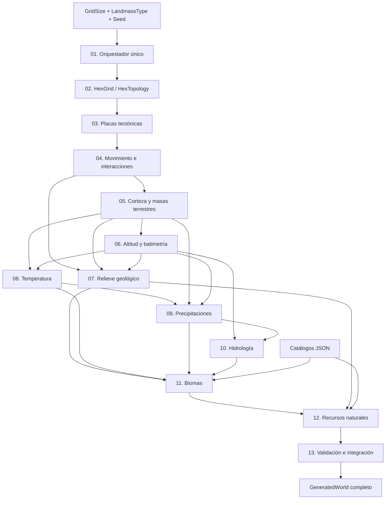

# Evolve — Roadmap de generación mundial

> **Rama de trabajo:** `worldgenerator`  
> **Documento rector:** [WORLD_GENERATION_ARCHITECTURE.md](WORLD_GENERATION_ARCHITECTURE.md)  
> **Estado actual:** H01–H04 conservados y cerrados por auditoría; experimentos H05 de Continents retirados; prioridad Pangea y capas posteriores compartidas. H06–H13 pendientes de sus respectivos gates. Ningún hito se considera completado por el simple hecho de existir una clase.
> **Objetivo final:** producir un mundo hexagonal determinista, coherente, persistible y consumible por la simulación y el renderer, para todos los tipos de mapa admitidos.

## Reglas del roadmap

- El código vigente en la rama `worldgenerator` es la fuente de verdad de implementación; este documento define el destino y los gates de aceptación.
- Marcar `[x]` únicamente cuando exista evidencia verificable: código integrado, compilación, validaciones y commit.
- No modificar `master` ni `develop` como parte de estos hitos; integrar después mediante PR autorizado.
- Preferir reutilizar los componentes de `GEvolve.Engine`, `GEvolve.State` y `GEvolve.Definitions`.
- No crear un segundo generador completo en paralelo, ni una carpeta de laboratorios/TEST, CSV o SVG temporales.
- Cada cambio de contrato o algoritmo debe acompañarse de actualización documental y nota de compatibilidad/versionado.
- **Alcance del mundo completo:** incluye grid, tectónica, tierra/océanos, relieve, clima, hidrología, biomas y población de recursos; renderizado de alta fidelidad y simulación de civilizaciones quedan fuera.

## 1. Vista general y dependencias



**Leyenda:** las flechas indican entradas indispensables. No asumir que una etapa posterior puede ejecutarse con arrays vacíos que simulan resultados.

## 2. Matriz de avance

| Hito | Resultado verificable | Estado actual |
|---|---|---|
| 01 — Orquestador | API de entrada única y resultados explícitos | **Completado y aprobado** |
| 02 — Grid | Topología determinista y seam E/O validado | **Completado y aprobado** |
| 03 — Placas | Partición conectada para todo tipo y tamaño | **Completado y aprobado** |
| 04 — Movimiento | Velocidades, interacciones y campos de esfuerzo | **Completado y aprobado** |
| 05 — Masas terrestres | Cuatro estrategias coherentes, incluido Continents | **Auditoría inicial en curso; implementación pendiente** |
| 06 — Elevación | Terreno 1–100 y mar 0 con batimetría separada | Parcial |
| 07 — Geología | Orogenia, arcos, volcanes, fallas y dorsales integrados | Parcial / por conectar |
| 08 — Temperatura | Campo térmico por celda en pipeline único | Implementación previa; por integrar |
| 09 — Precipitación | Humedad y precipitación geográficamente coherentes | Implementación previa; por integrar |
| 10 — Hidrología | Cuencas, ríos, lagos y flujo determinista | Por realizar |
| 11 — Biomas | Biomas por celda desde factores ambientales | Implementación previa; por integrar |
| 12 — Recursos | Flora, fauna y minerales por reglas y geología | Por realizar / auditar |
| 13 — Cierre | Mundo completo, persistencia, perfilado y revisión | Por realizar |

**Nota:** los estados reflejan los cierres documentales publicados hasta H04. Las implementaciones parciales de fases posteriores no implican aprobación del gate; `Continents` sigue pendiente de superficie.

## 3. Hitos y criterios de aceptación

### H01 — Orquestador único (COMPLETADO; aprobado por auditoría)

**Objetivo cumplido:** `WorldGenerationService` es el único orquestador de generación mundial. H01-A y H01-B1 a H01-B7 están completados y aprobados; este cierre arquitectónico **no** implica que todas las capas o tipos de mundo estén terminados.

- [x] Añadir `Generate(GridSize size, LandmassType type, int seed = 2026)` mediante `LandmassProfiles.Create`.
- [x] Conservar `Generate(LandmassConfiguration)` y su compatibilidad.
- [x] Inventariar y unificar llamadas a `WorldGenerationService` y `LandmassGenerationService` sin eliminar prematuramente rutas funcionales.
- [x] Mantener estado explícito `TectonicPreviewOnly` / `SurfaceGenerationPending` para `Continents`.
- [x] El orquestador solo coordina; las matemáticas permanecen en generadores especializados.

**Gate:** llamadas simples para todo `GridSize`/`LandmassType`; sin regresiones de resultados anteriores; error/resultado parcial inequívoco.  
**Archivos clave vigentes:** `World/WorldGenerationService.cs`, `World/LandmassGeneration/GeneratedWorld.cs`, generadores especializados y configuración de Definitions. `LandmassGenerationService` fue eliminado en H01-B4.

#### H01-A — API pública de generación (completado; aprobado por auditoría)

- [x] Añadir sobrecarga `Generate(GridSize size, LandmassType worldType, int seed = 2026)`.
- [x] Delegar a `LandmassProfiles.Create` y `Generate(LandmassConfiguration)` sin cambiar algoritmos.
- [x] Añadir pruebas de equivalencia en `StagedLandmassTests` para los cuatro tipos en tamaño Small, semilla por defecto y semilla alternativa.
- [x] Confirmar compilación y ejecución de pruebas en entorno .NET 10; validar también los demás tamaños con la suite existente.
- [x] Cerrar el gate H01-A tras verificar resultados y ausencia de regresiones.

**Evidencia de código:** `feat(worldgen): add unified world generation entry point` (`2f11e7cf672547ecfba984edfd772560003945d6`).  
**Evidencia de pruebas añadidas:** `test(worldgen): verify unified generation facade compatibility` (`687cb0d7647fd12814cb75c17b50b08519f6c4e6`).  
**Corrección de pruebas:** `test(worldgen): fix public facade statistics equivalence assertion` (`c4afe9eac11166c7f0be1174fb8d3d2072682d46`); igualdad estructural de `ComponentSizes` y comprobación de semilla alternativa para los cuatro tipos. El fallo original `Public facade matches existing generation for Pangaea` se observó en ejecución local antes de esta corrección.  
**Cierre formal H01-A:** auditoría arquitectónica aprobó el hito a partir del HEAD `04b0cef8fb5eabed989e4b964184612e595bcb9d`. La ejecución local .NET 10 confirmó compilación correcta de los cinco proyectos, equivalencia de la API pública, superficie y elevaciones válidas, determinismo y regresiones tectónicas, 12 baselines históricos y 36 geográficos; `GEvolve.Tests` finalizó sin excepciones. Este cierre es documental y no modifica algoritmos.

**Diagnóstico posterior a H01-A (Pangaea):** la suite reportó `Every finished world has oceans, land and 0..100 elevation (Small/Pangaea, max=100)`. En `PangaeaFromPlatesGenerator`, el percentil mínimo de potencial se cuantiza al nivel 0 también sobre tierra; el contrato de la prueba exige tierra > 0 y océano = 0. Se dividieron seis verificaciones con contadores de anomalías en `StagedLandmassTests` (commit `5128c9585758ce9a74d398314d28b2dcf8af09cc`). No se alteró ningún algoritmo. Falta ejecutar la suite para confirmar el número de celdas afectadas y verificar todos los tamaños. H01-A sigue abierto; cualquier corrección del generador requiere aprobación previa.

**Corrección autorizada de Pangaea (defecto preexistente, independiente de H01-A):** `PangaeaFromPlatesGenerator` cuantizaba algunas celdas terrestres al nivel 0. Con la autorización recibida se cambió exclusivamente el límite inferior del `Math.Clamp` final de 0 a 1, conservando océano 0 y tierra 1–100; commit `fix(worldgen): enforce positive land elevation in Pangaea` (`946144c8a1a93ed0ebaee01c5fa17878ca8edd15`). Evidencia local previa: Small/Pangaea tenía cuatro celdas terrestres en cero y cero celdas oceánicas con elevación positiva. Las seis aserciones diagnósticas permanecen activas. **Validación posterior al arreglo pendiente:** compilación, suite completa, tamaños Small/Medium/Large/Enormous, determinismo, equivalencia H01-A y perfiles. La reparación cambia algunos valores de altura al regenerar mundos Pangaea con la misma semilla; las partidas persistidas que ya guardan alturas no se migran automáticamente. `LandmassProfiles.CurrentGeneratorVersion` permanece en `landmass-12` y `PangaeaFromPlatesGenerator.Version` permanece en `pangaea-from-plates-1`; se requiere una decisión de compatibilidad/versionado antes de declarar reproducibilidad estricta entre versiones. No cerrar H01-A hasta validar y obtener aprobación de auditoría.

**Baselines de regresión Pangaea actualizados (autorización de auditoría):** la ejecución local de auditoría confirmó que únicamente cambiaron cuatro SHA-256 de elevación de Pangaea (Small, Medium, Large y Enormous; seed 2026). Se reemplazó exclusivamente el sexto campo de las cuatro filas en `TectonicMotionTerrainBaseline.txt`; intentos, máscaras, placas y otros tipos siguen intactos. Commit: `test(worldgen): update Pangaea elevation regression baselines` (`02bd9bce541637570aae69b37ebac2180b8dd7c8`). **No está aprobada aún la suite posterior a este commit**; ejecutar `dotnet build` y `dotnet run --project GEvolve.Tests` en entorno .NET 10 y registrar el resultado antes de cerrar H01-A. **Versionado pendiente de decisión:** `PangaeaFromPlatesGenerator.Version` es `pangaea-from-plates-1` y `LandmassProfiles.CurrentGeneratorVersion` es `landmass-12`; el segundo se integra en las configuraciones y una prueba de biomas comprueba literalmente `landmass-12`, mientras que no se encontró un consumidor directo del primero. No cambiar estos identificadores durante la actualización de baselines; cualquier cambio posterior requiere actualizar consumidores y pruebas conscientemente. La compatibilidad con mundos antiguos no es requisito durante esta etapa de desarrollo.

**Auditoría de `ApprovedNonContinentalBaseline.txt`:** la suite .NET 10 local pasó compilación, equivalencia H01-A, elevaciones para los cuatro tamaños, 12 hashes tectónicos y movimiento; se detuvo en `ContinentalGeologyTests.VerifyApprovedNonContinentalWorlds`. Se agregó instrumentación que compara intento, superficie, elevación y placas por separado y revisa los 36 escenarios antes de fallar (`test(worldgen): diagnose all approved non-continental baseline mismatches`, SHA `57afe808dc4f2765a08a460ac61e45faf969df5d`). **No se modificaron hashes ni algoritmos.** Pendiente: ejecutar localmente, obtener las discrepancias y verificar que únicamente correspondan a elevaciones Pangaea; luego actualizar solo esos hashes con evidencia y autorización condicionada. H01-A y suite global permanecen pendientes; H01-B no iniciado.

**Auditoría aprobada de 36 baselines no continentales (corrección de elevación Pangaea):** la ejecución local reportada confirmó 36 escenarios inspeccionados y exactamente 12 diferencias, todas en el hash SHA-256 de elevación de Pangaea para Small/Medium/Large/Enormous × semillas 2026, 42 y -731; sin diferencias en intentos, máscaras terrestres ni placas. Los 12 hashes aprobados se actualizaron en `ApprovedNonContinentalBaseline.txt` mediante `test(worldgen): refresh approved Pangaea elevation baselines` (`9602de4f65869a093c1121760e5920206f21e322`). Una comprobación de diff antes del commit verificó **exactamente 12 cambios del sexto campo** y los otros 24 escenarios intactos. Las aserciones estrictas se conservan. **Pendiente:** recompilar y ejecutar toda la suite *después* de la actualización para confirmar ausencia de nuevas excepciones; H01-A sigue abierto hasta aprobación formal de auditoría. H01-B no iniciado.

#### H01-B — Consolidación definitiva del orquestador (COMPLETADO; aprobado por auditoría)

**Objetivo aprobado:** un único orquestador mundial, `WorldGenerationService`, sin pipelines legacy permanentes. Preservar los algoritmos especializados y sus pruebas; no integrar anticipadamente clima, precipitaciones ni biomas. `Continents` mantiene superficie pendiente.

- [x] **H01-B1 — Validación geográfica especializada:** `LandmassProfileValidator.MeetsProfile` conserva los umbrales originales y todos sus consumidores fueron actualizados. **Aprobado por auditoría**, con ejecución local completa de `GEvolve.Tests` sin excepciones en HEAD `ff305a01e2e75d03da481d33396db8d6026b4510` (12 baselines históricos, 36 geográficos y equivalencia H01-A aprobados).
- [x] **H01-B2 — Pruebas geográficas oficiales:** `LandmassTests` migrado a `WorldGenerationService` (commit `af8bd7c62b2b0141c024b57aabd361f79a9c1f6f`); se mantienen perfiles, conectividad, seam, determinismo, variación por semilla, persistencia y Continents pendiente. **Aprobado por auditoría tras ejecución local completa de `GEvolve.Tests` sin excepciones: equivalencia H01-A, placas, movimiento, elevaciones, determinismo y 12+36 baselines.**
- [x] **H01-B3 — Pruebas ambientales independientes:** `TemperatureTests`, `PrecipitationTests`, `BiomeTests` y `PlateBoundaryTests` desacoplados del servicio legacy. **Aprobado por auditoría** tras la corrección `test(worldgen): restore environmental coverage after H01-B3 migration` (`8dbb215a98c8e3bd3a3f9529b398a186b1f83a95`), ejecución local de la suite completa y conservación de cobertura ambiental.
- [x] **H01-B4 — Eliminar pipeline landmass legacy:** retirados `PangaeaGenerator` y `LandmassGenerationService`; `GeneratedWorld` trasladado a archivo independiente preservando namespace y contrato. **Aprobado por auditoría:** compilación correcta de cinco proyectos .NET 10, suite `GEvolve.Tests` completa sin excepciones, equivalencia H01-A, 12 baselines tectónicos y 36 geográficos intactos, `Continents` con superficie pendiente; HEAD local validado `c0c91675e37e070972057004d7623be00666b8ff`, eliminación `refactor(worldgen): remove obsolete landmass generation pipeline` (`1445fa520c0623b0e51059372d62e94ad89e6a67`).
- [x] **H01-B5 — Simulación sobre estado oficial:** `SimulationEngine(GameState)` conserva la instancia de estado y ya no invoca `WorldSystem.Generar` ni expone `WorldMap`; `AdvanceTurn` y `AdvanceTurns` permanecen idénticos. `GEvolve.Tests/Program.cs` genera geografía exclusivamente desde `WorldGenerationService` fuera del motor, comprueba preservación de superficie, elevación, placas, temperatura, estado por referencia, avances y persistencia. **Aprobado por auditoría:** HEAD `8d8492e8c3d036bbd0fde5f6d170c3dd79c312ae`, compilación .NET 10 y suite completa aprobadas; commits `b5eb7dbdc3850b63df269933d2ee47677ed5e8bc` y `cd649f16ed0a5214696f4c527acbe1c3ca543463`.
- [x] **H01-B6 — Limpieza adicional:** `WorldTests` migrado a invariantes del orquestador oficial; eliminados `WorldSystem`, `WorldGenerator`, `WorldMap`, `GeneradorMasasTerrestres`, `GeneradorArchipielagos`, `GeneradorCordilleras`, `GeneradorBiomas` y `AnalizadorRelieve`, tras auditar sus consumidores. Los componentes de tectónica, geografía, clima, pendientes y biomas oficiales permanecen. **Aprobado por auditoría:** cinco proyectos .NET 10 compilados, `GEvolve.Tests` completo sin excepciones, equivalencia H01-A, 12 baselines tectónicos y 36 geográficos intactos; `Continents` conserva la superficie pendiente y `SimulationEngine` no genera geografía. Corrección posterior `fix(tests): correct span neighbor assertion in world tests` (`fa01641fe6f66f75870d7f711034505e6228a42c`), verificada localmente.
- [x] **H01-B7 — Auditoría final:** aprobada y cerrada tras eliminar los contratos y sobrecargas de generación de superficies sin placas tectónicas universales; `IPlateAwareLandmassGenerator` exige placas válidas. Commit de implementación validado: `refactor(worldgen): enforce universal plates in landmass generation contracts` (`3dbe5ea7ec67cb8aabf0f50b3af954d2a99ec64f`). La auditoría local confirmó build .NET 10 sin restauración, suite completa `GEvolve.Tests`, equivalencia H01-A, 12 baselines tectónicos y 36 geográficos.

**Gates H01-B1, H01-B2 y H01-B3:** aprobados formalmente por auditoría; H01-B3 validado sobre HEAD `8dbb215a98c8e3bd3a3f9529b398a186b1f83a95`. **Gate H01-B4 aprobado** por auditoría con suite local completa sobre HEAD `c0c91675e37e070972057004d7623be00666b8ff`. **H01-B5:** aprobado por auditoría con compilación y suite local .NET 10. **H01-B6:** gate aprobado por auditoría después de la corrección `fa01641fe6f66f75870d7f711034505e6228a42c`. **H01-B7:** aprobado y cerrado por auditoría sobre `3dbe5ea7ec67cb8aabf0f50b3af954d2a99ec64f`. **H01 completo:** cierre arquitectónico aprobado; los resultados deterministas oficiales permanecen intactos.

**H01-B3/H01-B4:** las cuatro pruebas dejaron de llamar `LandmassGenerationService` y las dos clases legacy fueron retiradas en H01-B4. No se alteraron semillas, algoritmos ni baselines. Verificar toda la suite antes de aprobar. `StagedLandmassTests`, `TectonicMotionTests` y `ContinentalGeologyTests` ya verifican el pipeline oficial. No modificar hashes oficiales ni algoritmos durante H01-B2.

**Alcance del cierre H01:** se retiraron los pipelines `LandmassGenerationService`, `PangaeaGenerator`, `WorldSystem`, `WorldGenerator` y sus auxiliares obsoletos; `SimulationEngine` consume `GameState` sin generar ni regenerar geografía. Las tres superficies implementadas conservan sus resultados deterministas aprobados. `Continents` sigue con `SurfaceGenerationPending` y sin superficie: se completará en su hito correspondiente. La integración de temperatura, precipitaciones, hidrología, biomas y demás etapas pertenece exclusivamente a hitos futuros; H02 no se inicia mediante este cierre.

### H02 — Cuadrícula y topología (COMPLETADO; aprobado por auditoría)

**Cierre formal:** H02 aprobado por auditoría arquitectónica tras revisar los cuatro archivos publicados en `test(worldgen): verify H02 hex grid topology and distance invariants` (`cf1db55a65aac42043cdeac767f73bf372988386`).

- [x] Confirmar los cuatro tamaños oficiales de `HexGridDefinitions`: **Small 200×133 = 26,600**, **Medium 250×167 = 41,750**, **Large 300×200 = 60,000** y **Enormous 400×267 = 106,800** celdas.
- [x] Verificar `CellId = row * Columns + column`, asignación única, estable y consistente con las coordenadas y arrays de datos; **235,150 celdas** auditadas.
- [x] Confirmar vecindad hexagonal de **cero a seis vecinos**, sin duplicados ni autorreferencias, simétrica y compatible con la topología oficial.
- [x] Confirmar continuidad horizontal **este-oeste en todas las filas** y bordes **norte/sur abiertos**, sin envoltura vertical.
- [x] Contrastar las distancias hexagonales, incluidos caminos que atraviesan la unión horizontal, mediante **diez recorridos BFS independientes por tamaño** y **150 comparaciones de distancia por tamaño**.
- [x] Verificar los contratos de rechazo de índices y coordenadas inválidos sin alterar la identidad ni la geometría oficial.
- [x] Distinguir la relación lógica de **columnas:filas ≈ 3:2** de las dimensiones físicas del hexágono `flat-top` y de la relación visual renderizada; no cambiar tamaños.
- [x] Medir la construcción de **Enormous** (tiempo, asignaciones, memoria retenida y GC) como **diagnóstico dependiente del hardware**, sin convertir las mediciones en umbrales de aceptación.
- [x] Registrar evidencia local: **`dotnet build` de .NET 10 sin errores ni advertencias**, suite completa **`dotnet run --project GEvolve.Tests` aprobada**, equivalencia **H01-A**, **12 baselines tectónicos** y **36 geográficos** intactos. `Continents` continúa explícitamente **pendiente de superficie**.

**Gate H02:** **APROBADO Y CERRADO** por auditoría. No se modificaron dimensiones, algoritmos, semillas, perfiles ni baselines con este cierre documental.

**Archivos clave:** `GEvolve.Engine/Grid/HexGrid.cs`, `GEvolve.Engine/World/LandmassGeneration/Shared/HexTopology.cs`, `GEvolve.Definitions/WorldGeneration/Configuration/HexGridDefinition.cs` y `GEvolve.Tests/GridTests.cs`.

### H03 — Placas tectónicas universales (COMPLETADO; aprobado por auditoría)

**Cierre formal:** auditoría arquitectónica aprobada sobre `test(worldgen): verify H03 universal tectonic plate invariants` (`0298640243f781506f5c03876282737aed0ef50f`). Compilación y suite local confirmadas **después del rebase** y con HEAD idéntico a dicho SHA.

- [x] Confirmar **16 placas tectónicas universales** con IDs 0..15 para los **cuatro tamaños** (Small, Medium, Large, Enormous), los **cuatro tipos de mundo** (Pangaea, SmallContinents, Archipelagos, Continents) y las **tres semillas oficiales** (2026, 42, -731).
- [x] Verificar cobertura completa: cada hexágono pertenece a una placa válida, las 16 placas están presentes y cada placa forma **una sola región conectada** por vecinos de `HexTopology`.
- [x] Verificar **fronteras tectónicas completas, canónicas y sin duplicados**, incluidas las aristas que atraviesan la continuidad horizontal este-oeste; no confundir placas con corteza, costas ni continentes.
- [x] Verificar determinismo de particiones completas con tamaños y semillas idénticos, y variación entre las tres semillas oficiales.
- [x] Confirmar persistencia del estado tectónico y conservación del orquestador oficial `WorldGenerationService`, sin alterar algoritmos, perfiles, semillas ni intentos.
- [x] Confirmar validación local posterior al rebase: `git rev-parse HEAD` devolvió `0298640243f781506f5c03876282737aed0ef50f`; `dotnet build` compiló correctamente los cinco proyectos .NET 10; `dotnet run --project GEvolve.Tests` finalizó con la suite completa aprobada, equivalencia H01-A, H02, **12 baselines tectónicos** y **36 baselines geográficos** intactos.
- [x] Mantener `Continents` **pendiente de superficie** en todos los tamaños y semillas; su previsualización tectónica no constituye una superficie oceánica generada.

**Gate H03:** **APROBADO Y CERRADO** por auditoría. La generación universal de placas y sus invariantes están comprobados.

**Archivo clave:** `Tectonics/TectonicPlateGenerator.cs`. Evidencia en `GEvolve.Tests/TectonicPlateTests.cs`.

### H04 — Movimiento y esfuerzo (COMPLETADO; aprobado por auditoría)

**Cierre formal:** auditoría de código y validación local aprobadas para `test(worldgen): verify H04 tectonic motion boundary invariants across official seeds` (`43e17150b8c760e18cce16ead6ddc0505ea5ab0b`). H04 conserva sin alteraciones los generadores tectónicos y la generación de superficies.

- [x] Verificar los **16 movimientos** por semilla: direcciones y velocidades válidas, streams RNG separados, determinismo e independencia del tamaño; matriz de **cuatro tamaños × tres semillas oficiales** (2026, 42 y -731).
- [x] Auditar todos los contactos reales de placa, su identidad y correspondencia uno a uno con `PlateBoundaryMap`; **44.830 contactos tectónicos** comprobados en los 12 escenarios oficiales, incluidos contactos que cruzan la unión **este-oeste**.
- [x] Verificar normales unitarias y antisimétricas, proyecciones de velocidad relativa en componentes normal y tangencial, y clasificación convergente, divergente, transformante, mixta o quieta.
- [x] Comprobar propagación gaussiana por distancia hexagonal, conservación de canales (compresión, extensión, cizalla), determinismo y campos finitos, no negativos y acotados.
- [x] Conservar la trazabilidad disponible entre contactos `PlateInteraction`, IDs de celdas, placas de origen, mapas de fronteras y campos de esfuerzo por celda. **Los campos agregados no guardan una referencia explícita a la frontera que aporta el máximo en cada celda**; esa procedencia detallada queda identificada como mejora futura, no como requisito de cierre H04.
- [x] Aclarar la independencia de las verificaciones: las **comparaciones masivas de proyección reutilizan `TectonicMotionGenerator.Project`**, mientras que las pruebas geométricas y de casos controlados ya existentes aportan las comprobaciones matemáticas independientes (normales, proyección, simetría y atenuación).
- [x] Confirmar `dotnet build` en .NET 10 y la suite completa `GEvolve.Tests` aprobados localmente; **12 hashes tectónicos** y **36 baselines geográficos** intactos.
- [x] Mantener separadas la generación de placas/movimiento y la generación de superficie; `Continents` conserva `SurfaceGenerationPending` y carece de superficie terminada.

**Gate H04:** **APROBADO Y CERRADO** por auditoría arquitectónica. Esfuerzos reproducibles y coherentes con fronteras y vecindad hexagonal; sin intensidades negativas ni valores no finitos.

**Archivos clave:** `PlateMotionGenerator`, `TectonicMotionGenerator`, `PlateBoundaryMap` y `GEvolve.Tests/TectonicMotionTests.cs`.

### Decisión de producto H05 — Familias de mundo (02-11-2026)

**Objetivo de catálogo:** reducir los tipos de generación seleccionables a **tres familias principales**:

1. **Continents:** de **dos a cuatro masas terrestres continentales principales** (componentes terrestres conectados usando `HexTopology`), con océanos que las separen. Se permiten islas menores sin contarlas como masas principales. Debe resultar del ensamblaje de fragmentos de corteza, no de asignar una placa a cada continente. Los criterios de tamaño mínimo, separación oceánica y aceptación se definirán y calibrarán en H05 antes de fijar umbrales.
2. **Pangaea:** **una sola masa terrestre conectada e irregular**, de escala supercontinental, con costas geológicamente plausibles. Mantener la topología horizontal y sus baselines hasta que cualquier cambio se apruebe explícitamente.
3. **Archipelagos:** conjunto de islas y archipiélagos, conservando su estrategia diferenciada y las regresiones aprobadas.

**Dos configuraciones especiales reservadas para una fase posterior (no implementarlas en H05):**

- **EarthReplica (nombre provisional):** recreación de la distribución geográfica del mundo real; especificar después la fidelidad, los datos de referencia y si es una plantilla determinista en vez de un tipo procedural nuevo.
- **InlandSea (nombre provisional):** gran superficie terrestre envolvente con **un mar interior central**. Definir después conexión con el océano exterior, si existe, y sus criterios topológicos.

**Migración necesaria:** `SmallContinents` deja de ser una familia seleccionable objetivo. Su implementación, pruebas y baselines históricos **no se eliminan ni se reinterpretan automáticamente**: inspeccionar primero todos los consumidores del enum, perfiles, persistencia, UI, pruebas y hashes. Mantener compatibilidad transitoria o retirar el tipo mediante un cambio controlado y con evidencia. Nunca sustituir sus entradas de baseline por las de `Continents` ni afirmar que el catálogo de tres tipos ya está implementado mientras el código continúe exponiendo cuatro.

**Orden de la arquitectura:** hex-grid → 16 placas universales → movimientos/esfuerzos → fragmentos y ensamblaje cortical → superficie emergida y océanos → elevaciones/geología (H06/H07) → clima e hidrología → biomas y recursos. Los tipos de mundo cambian las reglas de corteza/superficie, no la capa tectónica compartida.

### H05-M1/M2/M3 — Catálogo de tres tipos seleccionables (COMPLETADO; validación aprobada)

**Implementación publicada:** `feat(worldgen): expose three selectable world types with legacy compatibility` (`7ef53069a1b39956d6893bf9caf08b6544fc287d`). La auditoría revisó el diff de cinco archivos y confirmó localmente `dotnet build` y `dotnet run --project GEvolve.Tests` sin fallos después del fast-forward.

- [x] `SelectableWorldTypes` ofrece exactamente **Pangaea, Continents y Archipelagos** en creación y reconfiguración ordinaria.
- [x] IDs persistidos explícitos y estables: `Continents=0`, `Pangaea=1`, `SmallContinents=2`, `Archipelagos=3`.
- [x] `SmallContinents` permanece como tipo histórico interno: generación, perfil, serialización, pruebas y etiqueta de visualización conservados; no seleccionable como tipo nuevo.
- [x] `Continents` conserva el estado explícito de superficie pendiente hasta implementar corteza y masas continentales.
- [x] Validación local de los cinco proyectos .NET 10, suite completa, **12 hashes tectónicos y 36 baselines geográficos sin cambios**.

**Gate de migración del catálogo:** **APROBADO Y CERRADO**. Este cierre **no** completa H05 ni el generador de `Continents`; la siguiente fase es **H05-A — contrato cortical**, seguida de ensamblaje, clasificación de superficie, validación e integración. Los presets especiales EarthReplica/InlandSea continúan reservados para una fase futura.

### Reorientación posterior a H05 (5 de noviembre de 2026)

- **Retirado:** contrato cortical `shared-cortex-1`, fragmentación B1, ensamblaje B2, superficie B3, comparaciones A/B y C1 multiescala/PCG, sus selectores y pruebas. No conservar rutas experimentales muertas.
- **Conservado:** H01–H04, Pangea y su geometría aprobada, cuatro tamaños, flat-top E/O, 16 placas, movimiento y esfuerzos, relieve, temperatura, precipitaciones/humedad, pendientes, biomas, catálogos JSON, renderer y baselines existentes.
- **Tipos:** Pangea es prioridad; `Continents` queda pendiente sin corteza ni superficie; `Archipelagos` sigue disponible y `SmallContinents` permanece histórico. El catálogo de tipos seleccionables sigue intacto.
- **Historial:** comparar con el estado pre-H05 `fe067140895d14240717af9669285dd6939c9ef7`; los experimentos permanecen en commits antiguos y en `backup/worldgenerator-pre-h05-cleanup-20261105`.
- **Pruebas:** se han eliminado las suites y las opciones de consola exclusivas de los experimentos H05. Conservar las pruebas generales históricas. El usuario ejecutará `dotnet build`, `dotnet run --project GEvolve.Tests` y `dotnet run --project GEvolve.Game`.
- **Gate de esta limpieza:** pendiente de compilación, suite y revisión visual ejecutadas por el usuario. No iniciar desarrollos nuevos antes de aprobación.

### H05 — Corteza y masas terrestres (EXPERIMENTOS RETIRADOS; nueva estrategia pendiente)

**Estado:** iniciado el diagnóstico arquitectónico de los cuatro tipos de mundo. Los tres generadores con superficie terminada conservan sus baselines oficiales; `Continents` permanece en `SurfaceGenerationPending`. La fase de implementación requiere revisar el informe de auditoría y aprobar un plan por subhitos. No se autoriza cambiar algoritmos ni hashes por el simple hecho de iniciar H05.


- [ ] Auditar `Pangaea`, `SmallContinents`, `Archipelagos` y `Continents`.
- [ ] Completar `Continents` desde corteza/ensamblaje tectónico, sin equiparar placas con continentes.
- [ ] Mantener selección explícita por tipo, pero tectónica base compartida.
- [ ] Definir cuotas de superficie, componentes, contigüidad, tamaños y separación por tipo.
- [ ] Validar costas y continuidad por seam; evitar máscaras sin plausibilidad continental.
- [ ] Mantener intentos acotados y deterministas, diagnósticos de rechazo y resultados parciales explícitos.

**Gate:** todos los tipos producen tierra y océanos reales con perfil válido; `Continents` deja de estar pendiente solo tras pasar todas las comprobaciones.  
**Archivos clave:** `LandmassGeneration/*Generator.cs`, `ContinentalCrustMap`, `LandmassAnalysis`.

### H06 — Altitud y batimetría

- [ ] Distinguir `SurfaceByCellId`, `ElevationByCellId` y profundidad oceánica.
- [ ] Mantener elevación terrestre cuantizada 1–100 y mar nivel 0 cuando corresponda a la representación actual.
- [ ] Comprobar transición costa–llanura–meseta–alta montaña.
- [ ] Evitar ruido que genere picos aislados sin explicación geológica.
- [ ] Definir explícitamente cualquier conversión futura entre niveles del juego y metros físicos.

**Gate:** no hay celdas tierra/mar contradictorias; arrays completos; perfiles reproducibles.  
**Archivos clave:** `PlateAwareElevationGenerator`, modelos de `LandmassState`.

### H07 — Geología y accidentes tectónicos

- [ ] Conectar el relieve a contactos reales placa/corteza.
- [ ] Integrar colisión continental, subducción, divergencia y transformantes.
- [ ] Derivar cinturones montañosos, fallas, rifts, arcos volcánicos, dorsales y fosas.
- [ ] Conservar continuidad regional y procedencia geológica de cada accidente.
- [ ] Si el volcanismo emerge nuevas islas, recalcular superficie/estadísticas y capas dependientes.

**Gate:** los accidentes coinciden con causas tectónicas rastreables; sin modificaciones de superficie ocultas.  
**Archivo clave:** `ContinentalReliefGenerator.cs`; dependencias de tectónica/corteza.

### H08 — Temperatura

- [ ] Auditar la implementación existente de `TemperatureGenerator`.
- [ ] Integrarla después de superficie/elevación en el orquestador único.
- [ ] Definir latitud, temperatura base, gradiente altitudinal y continentalidad.
- [ ] Documentar si el modelo representa media anual o estacionalidad.
- [ ] Estabilizar unidades y rangos físicos, evitando asumir que altura 0–100 equivale a km.

**Gate:** cobertura térmica total, finitud, patrones latitudinales y efecto altitudinal plausibles.  
**Archivo clave:** `World/Climate/TemperatureGenerator.cs` (verificar ubicación exacta).

### H09 — Precipitaciones y humedad

- [ ] Auditar e integrar `PrecipitationGenerator`.
- [ ] Considerar fuentes oceánicas, transporte de humedad, vientos, relieve y sombra orográfica.
- [ ] Separar precipitación de humedad del suelo si ambas se necesitan.
- [ ] Usar ruido solo como variación secundaria, no como causa principal.
- [ ] Definir unidades y rangos, evitando ciclos con hidrología.

**Gate:** continentes interiores, barlovento y sotavento reflejan dependencias físicas; cobertura completa y reproducible.

### H10 — Hidrología

- [ ] Definir algoritmo de flujo sobre los seis vecinos.
- [ ] Tratar cuencas, depresiones, divisorias, lagos y endorreísmo.
- [ ] Acumular escorrentía/caudal dependiente de precipitación y pendiente.
- [ ] Extraer redes de ríos con salidas al mar o cuencas terminales.
- [ ] Garantizar drenaje sin ciclos no controlados y sin ríos que asciendan artificialmente.
- [ ] Mantener hidrología separada de rasgos tectónicos aunque el renderer los muestre juntos.

**Gate:** rutas de flujo coherentes, conservación de acumulación según el modelo y cuencas cerradas solo cuando sean deliberadas.

### H11 — Biomas

- [ ] Auditar clasificación existente y catálogos JSON de biomas.
- [ ] Clasificar por temperatura, precipitación/humedad, elevación, hidrología y geología cuando corresponda.
- [ ] Priorizar reglas de forma explícita: mar, costa, cumbres, humedales, regiones climáticas.
- [ ] Verificar referencias de IDs y cobertura de toda celda válida.
- [ ] Distinguir clasificación física del bioma de su contenido potencial.

**Gate:** ninguna celda queda sin bioma válido; no aparecen clasificaciones físicamente contradictorias.

### H12 — Recursos naturales y ecosistemas

- [ ] Vincular flora a biomas, humedad, temperatura y condiciones locales.
- [ ] Vincular fauna a biomas, hábitats y reglas de distribución.
- [ ] Vincular minerales a contexto geológico y afloramientos, no únicamente a biomas.
- [ ] Leer catálogos JSON mediante contratos de IDs y relaciones válidas.
- [ ] Definir `available`/elegible vs. `spawn` efectivo; usar RNG separado.
- [ ] Mantener la población de recursos desacoplada de la clasificación ambiental.

**Gate:** recursos reproducibles, referencias existentes, distribuciones ecológica/geológicamente posibles y sin duplicidad accidental.

### H13 — Mundo completo y entrega al juego

- [ ] Diseñar una condición formal `WorldReady` basada en capas requeridas, no solo en ausencia de excepciones.
- [ ] Devolver resultado por API única; renderer y simulación consumen datos sin regenerarlos.
- [ ] Comprobar persistencia/serialización, versiones del generador y reproducibilidad de carga.
- [ ] Verificar tamaños/semillas/tipos en una matriz de regresión.
- [ ] Medir memoria, duración por fase y GC en tamaños reales (especialmente el mayor).
- [ ] Generar métricas de QA: cobertura, componentes, rangos, conectividad, integridad de ríos/biomas/recursos.
- [ ] Actualizar arquitectura, roadmap, notas de migración y evidencia de cierre.

**Gate FINAL:** los cuatro tipos de mundo devuelven un `GeneratedWorld` utilizable, con todas las capas habilitadas y validadas, sin depender del renderer ni de herramientas temporales.

## 4. Protocolo de entrega por hito

Por cada fase se debe conservar:

1. **Diagnóstico previo:** archivos actuales, comportamiento, diferencias con el objetivo y riesgos.
2. **Contrato técnico:** entradas, salidas, unidad/rango, invariantes, dependencia y versión.
3. **Implementación:** modificación mínima de clases existentes y nuevas clases solo si aportan responsabilidades distintas.
4. **Validación:** compilación, fixtures deterministas, casos límite, continuidad E/O y escenarios de todas las familias de mapa.
5. **Evidencia:** resultados observados y limitaciones; no marcar aprobado por resultados visuales exclusivamente.
6. **Documentación:** actualizar este roadmap y `WORLD_GENERATION_ARCHITECTURE.md`.
7. **Commit:** siempre reportar mensaje completo de Conventional Commits, SHA y rama.

## 5. Política Git

```text
master            estable
  └── develop     integración
       └── worldgenerator  trabajo actual
```

Los commits de hitos se realizan en `worldgenerator`. Los merges `worldgenerator → develop → master` se realizan mediante PR y revisión autorizada. No utilizar `reset --hard`, `push --force` ni modificar ramas protegidas como mecanismo rutinario.

## 6. Criterios transversales

- **Determinismo:** misma configuración, versiones y semilla deben reproducir capas para un entorno de referencia.
- **Topología:** ningún generador puede romper el seam horizontal.
- **Alineación:** todo array por celda usa los índices de la misma `HexTopology`.
- **Estados parciales:** `Continents` no puede declararse finalizado mientras su superficie esté pendiente.
- **Datos derivados:** toda alteración de tierra/altura invalida las capas dependientes que ya se hubieran calculado.
- **Versionado:** los cambios de algoritmo que alteren mapas requieren versión y nota de compatibilidad con saves.
- **Rendimiento:** evitar pasadas redundantes, buffers innecesarios y búsquedas de costo cuadrático sin perfilar.
- **Calidad científica:** separar simplificaciones conscientes de errores de simulación.

## 7. Próximo paso

**H01–H04 completados y aprobados por auditoría.** El trabajo activo vuelve a **Pangea**, para completar y validar sus capas compartidas antes de adaptar el pipeline a `Continents` y demás tipos. El seguimiento detallado está en [PANGAEA_ROADMAP.md](PANGAEA_ROADMAP.md): P03-A.7.1 incorpora motor temporal por etapas conservando exactamente los resultados P03-A.6, con equivalencia original/automática/manual verificada. P03-A.7.2 añade la interfaz manual interna y el consumo de capas parciales sin cambiar los generadores; pendiente de aprobación visual exclusiva del usuario. P03-A.7.3–7.4 quedan planificados (comparación y auditoría integral); P03-B no iniciado. P03-A.6 sigue pendiente de revisión visual; P03-A no aprobado y los baselines históricos de elevación no se actualizan. Los experimentos H05 de corteza y superficie de Continents están retirados del código operativo y disponibles solo en el historial. **H06 aún no iniciado.**

Esta planificación se actualiza con evidencia de código, pruebas y commits; no sustituye la documentación de arquitectura ni declara finalizadas las implementaciones pendientes.
