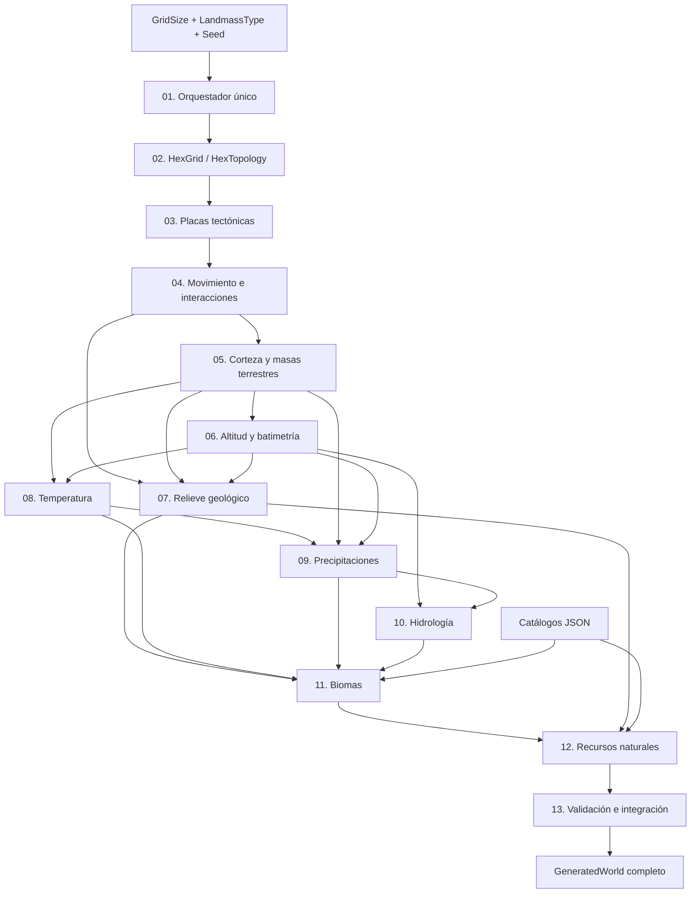

# Evolve — Roadmap de generación mundial

> **Rama de trabajo:** `worldgenerator`  
> **Documento rector:** [WORLD_GENERATION_ARCHITECTURE.md](WORLD_GENERATION_ARCHITECTURE.md)  
> **Estado:** planificación; ningún hito se considera completado por el simple hecho de existir una clase.
> **Objetivo final:** producir un mundo hexagonal determinista, coherente, persistible y consumible por la simulación y el renderer, para todos los tipos de mapa admitidos.

## Reglas del roadmap

- El código vigente en la rama `worldgenerator` es la fuente de verdad de implementación; este documento define el destino y los gates de aceptación.
- Marcar `[x]` únicamente cuando exista evidencia verificable: código integrado, compilación, validaciones y commit.
- No modificar `master` ni `develop` como parte de estos hitos; integrar después mediante PR autorizado.
- Preferir reutilizar los componentes de `GEvolve.Engine`, `GEvolve.State` y `GEvolve.Definitions`.
- No crear un segundo generador completo en paralelo, ni una carpeta de laboratorios/TEST, CSV o SVG temporales.
- Cada cambio de contrato o algoritmo debe acompañarse de actualización documental y nota de compatibilidad/versionado.
- **Alcance del mundo completo:** incluye grid, tectónica, tierra/océanos, relieve, clima, hidrología, biomas y población de recursos; renderizado de alta fidelidad y simulación de civilizaciones quedan fuera.

## 1. Vista general y dependencias



**Leyenda:** las flechas indican entradas indispensables. No asumir que una etapa posterior puede ejecutarse con arrays vacíos que simulan resultados.

## 2. Matriz de avance

| Hito | Resultado verificable | Estado inicial |
|---|---|---|
| 01 — Orquestador | API de entrada única y resultados explícitos | H01-A aprobado; H01-B pendiente |
| 02 — Grid | Topología determinista y seam E/O validado | Base existente; pendiente de gate |
| 03 — Placas | Partición conectada para todo tipo y tamaño | Base existente; pendiente de gate |
| 04 — Movimiento | Velocidades, interacciones y campos de esfuerzo | Base existente; pendiente de gate |
| 05 — Masas terrestres | Cuatro estrategias coherentes, incluido Continents | Incompleto |
| 06 — Elevación | Terreno 1–100 y mar 0 con batimetría separada | Parcial |
| 07 — Geología | Orogenia, arcos, volcanes, fallas y dorsales integrados | Parcial / por conectar |
| 08 — Temperatura | Campo térmico por celda en pipeline único | Implementación previa; por integrar |
| 09 — Precipitación | Humedad y precipitación geográficamente coherentes | Implementación previa; por integrar |
| 10 — Hidrología | Cuencas, ríos, lagos y flujo determinista | Por realizar |
| 11 — Biomas | Biomas por celda desde factores ambientales | Implementación previa; por integrar |
| 12 — Recursos | Flora, fauna y minerales por reglas y geología | Por realizar / auditar |
| 13 — Cierre | Mundo completo, persistencia, perfilado y revisión | Por realizar |

**Nota:** el estado inicial describe el código revisado al planificar; actualizar tras inspeccionar commits posteriores.

## 3. Hitos y criterios de aceptación

### H01 — Orquestador único

**Objetivo:** `WorldGenerationService` es la única fachada pública recomendada.

- [ ] Añadir `Generate(GridSize size, LandmassType type, int seed = 2026)` mediante `LandmassProfiles.Create`.
- [ ] Conservar `Generate(LandmassConfiguration)` y su compatibilidad.
- [ ] Inventariar y unificar llamadas a `WorldGenerationService` y `LandmassGenerationService` sin eliminar prematuramente rutas funcionales.
- [ ] Mantener estado explícito `TectonicPreviewOnly` / `SurfaceGenerationPending` para `Continents`.
- [ ] El orquestador solo coordina; las matemáticas permanecen en generadores especializados.

**Gate:** llamadas simples para todo `GridSize`/`LandmassType`; sin regresiones de resultados anteriores; error/resultado parcial inequívoco.  
**Archivos clave:** `World/WorldGenerationService.cs`, `World/LandmassGeneration/LandmassGenerationService.cs`, configuración de Definitions.

#### H01-A — API pública de generación (completado; aprobado por auditoría)

- [x] Añadir sobrecarga `Generate(GridSize size, LandmassType worldType, int seed = 2026)`.
- [x] Delegar a `LandmassProfiles.Create` y `Generate(LandmassConfiguration)` sin cambiar algoritmos.
- [x] Añadir pruebas de equivalencia en `StagedLandmassTests` para los cuatro tipos en tamaño Small, semilla por defecto y semilla alternativa.
- [x] Confirmar compilación y ejecución de pruebas en entorno .NET 10; validar también los demás tamaños con la suite existente.
- [x] Cerrar el gate H01-A tras verificar resultados y ausencia de regresiones.

**Evidencia de código:** `feat(worldgen): add unified world generation entry point` (`2f11e7cf672547ecfba984edfd772560003945d6`).  
**Evidencia de pruebas añadidas:** `test(worldgen): verify unified generation facade compatibility` (`687cb0d7647fd12814cb75c17b50b08519f6c4e6`).  
**Corrección de pruebas:** `test(worldgen): fix public facade statistics equivalence assertion` (`c4afe9eac11166c7f0be1174fb8d3d2072682d46`); igualdad estructural de `ComponentSizes` y comprobación de semilla alternativa para los cuatro tipos. El fallo original `Public facade matches existing generation for Pangaea` se observó en ejecución local antes de esta corrección.  
**Cierre formal H01-A:** auditoría arquitectónica aprobó el hito a partir del HEAD `04b0cef8fb5eabed989e4b964184612e595bcb9d`. La ejecución local .NET 10 confirmó compilación correcta de los cinco proyectos, equivalencia de la API pública, superficie y elevaciones válidas, determinismo y regresiones tectónicas, 12 baselines históricos y 36 geográficos; `GEvolve.Tests` finalizó sin excepciones. Este cierre es documental y no modifica algoritmos.

**Diagnóstico posterior a H01-A (Pangaea):** la suite reportó `Every finished world has oceans, land and 0..100 elevation (Small/Pangaea, max=100)`. En `PangaeaFromPlatesGenerator`, el percentil mínimo de potencial se cuantiza al nivel 0 también sobre tierra; el contrato de la prueba exige tierra > 0 y océano = 0. Se dividieron seis verificaciones con contadores de anomalías en `StagedLandmassTests` (commit `5128c9585758ce9a74d398314d28b2dcf8af09cc`). No se alteró ningún algoritmo. Falta ejecutar la suite para confirmar el número de celdas afectadas y verificar todos los tamaños. H01-A sigue abierto; cualquier corrección del generador requiere aprobación previa.

**Corrección autorizada de Pangaea (defecto preexistente, independiente de H01-A):** `PangaeaFromPlatesGenerator` cuantizaba algunas celdas terrestres al nivel 0. Con la autorización recibida se cambió exclusivamente el límite inferior del `Math.Clamp` final de 0 a 1, conservando océano 0 y tierra 1–100; commit `fix(worldgen): enforce positive land elevation in Pangaea` (`946144c8a1a93ed0ebaee01c5fa17878ca8edd15`). Evidencia local previa: Small/Pangaea tenía cuatro celdas terrestres en cero y cero celdas oceánicas con elevación positiva. Las seis aserciones diagnósticas permanecen activas. **Validación posterior al arreglo pendiente:** compilación, suite completa, tamaños Small/Medium/Large/Enormous, determinismo, equivalencia H01-A y perfiles. La reparación cambia algunos valores de altura al regenerar mundos Pangaea con la misma semilla; las partidas persistidas que ya guardan alturas no se migran automáticamente. `LandmassProfiles.CurrentGeneratorVersion` permanece en `landmass-12` y `PangaeaFromPlatesGenerator.Version` permanece en `pangaea-from-plates-1`; se requiere una decisión de compatibilidad/versionado antes de declarar reproducibilidad estricta entre versiones. No cerrar H01-A hasta validar y obtener aprobación de auditoría.

**Baselines de regresión Pangaea actualizados (autorización de auditoría):** la ejecución local de auditoría confirmó que únicamente cambiaron cuatro SHA-256 de elevación de Pangaea (Small, Medium, Large y Enormous; seed 2026). Se reemplazó exclusivamente el sexto campo de las cuatro filas en `TectonicMotionTerrainBaseline.txt`; intentos, máscaras, placas y otros tipos siguen intactos. Commit: `test(worldgen): update Pangaea elevation regression baselines` (`02bd9bce541637570aae69b37ebac2180b8dd7c8`). **No está aprobada aún la suite posterior a este commit**; ejecutar `dotnet build` y `dotnet run --project GEvolve.Tests` en entorno .NET 10 y registrar el resultado antes de cerrar H01-A. **Versionado pendiente de decisión:** `PangaeaFromPlatesGenerator.Version` es `pangaea-from-plates-1` y `LandmassProfiles.CurrentGeneratorVersion` es `landmass-12`; el segundo se integra en las configuraciones y una prueba de biomas comprueba literalmente `landmass-12`, mientras que no se encontró un consumidor directo del primero. No cambiar estos identificadores durante la actualización de baselines; cualquier cambio posterior requiere actualizar consumidores y pruebas conscientemente. La compatibilidad con mundos antiguos no es requisito durante esta etapa de desarrollo.

**Auditoría de `ApprovedNonContinentalBaseline.txt`:** la suite .NET 10 local pasó compilación, equivalencia H01-A, elevaciones para los cuatro tamaños, 12 hashes tectónicos y movimiento; se detuvo en `ContinentalGeologyTests.VerifyApprovedNonContinentalWorlds`. Se agregó instrumentación que compara intento, superficie, elevación y placas por separado y revisa los 36 escenarios antes de fallar (`test(worldgen): diagnose all approved non-continental baseline mismatches`, SHA `57afe808dc4f2765a08a460ac61e45faf969df5d`). **No se modificaron hashes ni algoritmos.** Pendiente: ejecutar localmente, obtener las discrepancias y verificar que únicamente correspondan a elevaciones Pangaea; luego actualizar solo esos hashes con evidencia y autorización condicionada. H01-A y suite global permanecen pendientes; H01-B no iniciado.

**Auditoría aprobada de 36 baselines no continentales (corrección de elevación Pangaea):** la ejecución local reportada confirmó 36 escenarios inspeccionados y exactamente 12 diferencias, todas en el hash SHA-256 de elevación de Pangaea para Small/Medium/Large/Enormous × semillas 2026, 42 y -731; sin diferencias en intentos, máscaras terrestres ni placas. Los 12 hashes aprobados se actualizaron en `ApprovedNonContinentalBaseline.txt` mediante `test(worldgen): refresh approved Pangaea elevation baselines` (`9602de4f65869a093c1121760e5920206f21e322`). Una comprobación de diff antes del commit verificó **exactamente 12 cambios del sexto campo** y los otros 24 escenarios intactos. Las aserciones estrictas se conservan. **Pendiente:** recompilar y ejecutar toda la suite *después* de la actualización para confirmar ausencia de nuevas excepciones; H01-A sigue abierto hasta aprobación formal de auditoría. H01-B no iniciado.

#### H01-B — Consolidación definitiva del orquestador (en curso, sin cierre de auditoría)

**Objetivo aprobado:** un único orquestador mundial, `WorldGenerationService`, sin pipelines legacy permanentes. Preservar los algoritmos especializados y sus pruebas; no integrar anticipadamente clima, precipitaciones ni biomas. `Continents` mantiene superficie pendiente.

- [ ] **H01-B1 — Validación geográfica especializada:** extraer `LandmassGenerationService.MeetsProfile` a `LandmassProfileValidator.MeetsProfile`, conservando sin cambios los umbrales y migrando llamadas en motor y pruebas. **Implementado; pendiente de compilación, suite .NET 10 y aprobación formal de auditoría.**
- [ ] **H01-B2 — Pruebas geográficas oficiales:** migrar pruebas de generación geográfica al `WorldGenerationService` y mantener determinismo, perfiles, hashes e invariantes.
- [ ] **H01-B3 — Pruebas ambientales independientes:** desacoplar `TemperatureTests`, `PrecipitationTests`, `BiomeTests` y pruebas de pendientes de la generación legacy, conservando su cobertura sin adelantar las etapas del DAG.
- [ ] **H01-B4 — Eliminar pipeline landmass legacy:** retirar `PangaeaGenerator` y `LandmassGenerationService` tras resolver todos sus consumidores; conservar generadores de masas especializados.
- [ ] **H01-B5 — Simulación sobre estado oficial:** retirar la dependencia de `SimulationEngine` respecto a `WorldSystem` sin generar de nuevo el mundo.
- [ ] **H01-B6 — Limpieza adicional:** eliminar `WorldSystem`, `WorldGenerator` y auxiliares obsoletos solo después de migrar consumidores y cobertura.
- [ ] **H01-B7 — Auditoría final:** verificar un único orquestador, DAG, cuatro tipos (Continents aún parcial), persistencia, baselines y suite completa .NET 10.

**Gate H01-B1:** igualdad exacta de umbrales y resultados, ninguna referencia restante a `LandmassGenerationService.MeetsProfile`, equivalencia H01-A y baselines oficiales intactos. No iniciar H01-B2 hasta aprobación explícita.

### H02 — Cuadrícula y topología

- [ ] Confirmar enumeraciones de tamaños, total de celdas, correspondencia `CellId` y geometría 3:2 acordada para visualización, sin confundir aspecto visual con vecindad.
- [ ] Garantizar un único índice por hexágono y como máximo seis vecinos distintos.
- [ ] Comprobar conexión horizontal E/O, ausencia de envoltura vertical y distancias sobre seam.
- [ ] Validar la escala y memoria para el tamaño más grande realmente definido.

**Gate:** identidad, vecindad y conectividad consistentes en todos los tamaños.  
**Archivos clave:** `GEvolve.Engine.Grid`, `HexTopology`, `HexGridDefinitions`.

### H03 — Placas tectónicas universales

- [ ] Confirmar que el mismo `TectonicPlateGenerator` sirve todos los tipos.
- [ ] Verificar cobertura completa, IDs válidos, conectividad de cada placa y fronteras irregulares.
- [ ] Conservar separación entre placa tectónica y tipo de corteza.
- [ ] Documentar cantidad de placas real de la versión implementada (en `master` consultado: 16), sin cambiarla sin decisión independiente.
- [ ] Confirmar reproducibilidad de partición para tamaño y seed idénticos.

**Gate:** ningún hexágono queda sin placa; sin regiones de placa desconectadas.  
**Archivo clave:** `Tectonics/TectonicPlateGenerator.cs`.

### H04 — Movimiento y esfuerzo

- [ ] Auditar velocidades, direcciones y streams RNG deterministas.
- [ ] Comprobar clasificación de bordes: convergentes, divergentes, transformantes, mixtos y quietos.
- [ ] Validar proyecciones normal/tangente y costura E/O.
- [ ] Verificar propagación gaussiana, finitud y límites de intensidad.
- [ ] Exponer trazabilidad de qué bordes producen deformación por celda.

**Gate:** esfuerzos repetibles y geográficamente coherentes; no NaN ni intensidades negativas.  
**Archivos clave:** `PlateMotionGenerator`, `TectonicMotionGenerator`, `PlateBoundaryMap`.

### H05 — Corteza y masas terrestres

- [ ] Auditar `Pangaea`, `SmallContinents`, `Archipelagos` y `Continents`.
- [ ] Completar `Continents` desde corteza/ensamblaje tectónico, sin equiparar placas con continentes.
- [ ] Mantener selección explícita por tipo, pero tectónica base compartida.
- [ ] Definir cuotas de superficie, componentes, contigüidad, tamaños y separación por tipo.
- [ ] Validar costas y continuidad por seam; evitar máscaras sin plausibilidad continental.
- [ ] Mantener intentos acotados y deterministas, diagnósticos de rechazo y resultados parciales explícitos.

**Gate:** todos los tipos producen tierra y océanos reales con perfil válido; `Continents` deja de estar pendiente solo tras pasar todas las comprobaciones.  
**Archivos clave:** `LandmassGeneration/*Generator.cs`, `ContinentalCrustMap`, `LandmassAnalysis`.

### H06 — Altitud y batimetría

- [ ] Distinguir `SurfaceByCellId`, `ElevationByCellId` y profundidad oceánica.
- [ ] Mantener elevación terrestre cuantizada 1–100 y mar nivel 0 cuando corresponda a la representación actual.
- [ ] Comprobar transición costa–llanura–meseta–alta montaña.
- [ ] Evitar ruido que genere picos aislados sin explicación geológica.
- [ ] Definir explícitamente cualquier conversión futura entre niveles del juego y metros físicos.

**Gate:** no hay celdas tierra/mar contradictorias; arrays completos; perfiles reproducibles.  
**Archivos clave:** `PlateAwareElevationGenerator`, modelos de `LandmassState`.

### H07 — Geología y accidentes tectónicos

- [ ] Conectar el relieve a contactos reales placa/corteza.
- [ ] Integrar colisión continental, subducción, divergencia y transformantes.
- [ ] Derivar cinturones montañosos, fallas, rifts, arcos volcánicos, dorsales y fosas.
- [ ] Conservar continuidad regional y procedencia geológica de cada accidente.
- [ ] Si el volcanismo emerge nuevas islas, recalcular superficie/estadísticas y capas dependientes.

**Gate:** los accidentes coinciden con causas tectónicas rastreables; sin modificaciones de superficie ocultas.  
**Archivo clave:** `ContinentalReliefGenerator.cs`; dependencias de tectónica/corteza.

### H08 — Temperatura

- [ ] Auditar la implementación existente de `TemperatureGenerator`.
- [ ] Integrarla después de superficie/elevación en el orquestador único.
- [ ] Definir latitud, temperatura base, gradiente altitudinal y continentalidad.
- [ ] Documentar si el modelo representa media anual o estacionalidad.
- [ ] Estabilizar unidades y rangos físicos, evitando asumir que altura 0–100 equivale a km.

**Gate:** cobertura térmica total, finitud, patrones latitudinales y efecto altitudinal plausibles.  
**Archivo clave:** `World/Climate/TemperatureGenerator.cs` (verificar ubicación exacta).

### H09 — Precipitaciones y humedad

- [ ] Auditar e integrar `PrecipitationGenerator`.
- [ ] Considerar fuentes oceánicas, transporte de humedad, vientos, relieve y sombra orográfica.
- [ ] Separar precipitación de humedad del suelo si ambas se necesitan.
- [ ] Usar ruido solo como variación secundaria, no como causa principal.
- [ ] Definir unidades y rangos, evitando ciclos con hidrología.

**Gate:** continentes interiores, barlovento y sotavento reflejan dependencias físicas; cobertura completa y reproducible.

### H10 — Hidrología

- [ ] Definir algoritmo de flujo sobre los seis vecinos.
- [ ] Tratar cuencas, depresiones, divisorias, lagos y endorreísmo.
- [ ] Acumular escorrentía/caudal dependiente de precipitación y pendiente.
- [ ] Extraer redes de ríos con salidas al mar o cuencas terminales.
- [ ] Garantizar drenaje sin ciclos no controlados y sin ríos que asciendan artificialmente.
- [ ] Mantener hidrología separada de rasgos tectónicos aunque el renderer los muestre juntos.

**Gate:** rutas de flujo coherentes, conservación de acumulación según el modelo y cuencas cerradas solo cuando sean deliberadas.

### H11 — Biomas

- [ ] Auditar clasificación existente y catálogos JSON de biomas.
- [ ] Clasificar por temperatura, precipitación/humedad, elevación, hidrología y geología cuando corresponda.
- [ ] Priorizar reglas de forma explícita: mar, costa, cumbres, humedales, regiones climáticas.
- [ ] Verificar referencias de IDs y cobertura de toda celda válida.
- [ ] Distinguir clasificación física del bioma de su contenido potencial.

**Gate:** ninguna celda queda sin bioma válido; no aparecen clasificaciones físicamente contradictorias.

### H12 — Recursos naturales y ecosistemas

- [ ] Vincular flora a biomas, humedad, temperatura y condiciones locales.
- [ ] Vincular fauna a biomas, hábitats y reglas de distribución.
- [ ] Vincular minerales a contexto geológico y afloramientos, no únicamente a biomas.
- [ ] Leer catálogos JSON mediante contratos de IDs y relaciones válidas.
- [ ] Definir `available`/elegible vs. `spawn` efectivo; usar RNG separado.
- [ ] Mantener la población de recursos desacoplada de la clasificación ambiental.

**Gate:** recursos reproducibles, referencias existentes, distribuciones ecológica/geológicamente posibles y sin duplicidad accidental.

### H13 — Mundo completo y entrega al juego

- [ ] Diseñar una condición formal `WorldReady` basada en capas requeridas, no solo en ausencia de excepciones.
- [ ] Devolver resultado por API única; renderer y simulación consumen datos sin regenerarlos.
- [ ] Comprobar persistencia/serialización, versiones del generador y reproducibilidad de carga.
- [ ] Verificar tamaños/semillas/tipos en una matriz de regresión.
- [ ] Medir memoria, duración por fase y GC en tamaños reales (especialmente el mayor).
- [ ] Generar métricas de QA: cobertura, componentes, rangos, conectividad, integridad de ríos/biomas/recursos.
- [ ] Actualizar arquitectura, roadmap, notas de migración y evidencia de cierre.

**Gate FINAL:** los cuatro tipos de mundo devuelven un `GeneratedWorld` utilizable, con todas las capas habilitadas y validadas, sin depender del renderer ni de herramientas temporales.

## 4. Protocolo de entrega por hito

Por cada fase se debe conservar:

1. **Diagnóstico previo:** archivos actuales, comportamiento, diferencias con el objetivo y riesgos.
2. **Contrato técnico:** entradas, salidas, unidad/rango, invariantes, dependencia y versión.
3. **Implementación:** modificación mínima de clases existentes y nuevas clases solo si aportan responsabilidades distintas.
4. **Validación:** compilación, fixtures deterministas, casos límite, continuidad E/O y escenarios de todas las familias de mapa.
5. **Evidencia:** resultados observados y limitaciones; no marcar aprobado por resultados visuales exclusivamente.
6. **Documentación:** actualizar este roadmap y `WORLD_GENERATION_ARCHITECTURE.md`.
7. **Commit:** siempre reportar mensaje completo de Conventional Commits, SHA y rama.

## 5. Política Git

```text
master            estable
  └── develop     integración
       └── worldgenerator  trabajo actual
```

Los commits de hitos se realizan en `worldgenerator`. Los merges `worldgenerator → develop → master` se realizan mediante PR y revisión autorizada. No utilizar `reset --hard`, `push --force` ni modificar ramas protegidas como mecanismo rutinario.

## 6. Criterios transversales

- **Determinismo:** misma configuración, versiones y semilla deben reproducir capas para un entorno de referencia.
- **Topología:** ningún generador puede romper el seam horizontal.
- **Alineación:** todo array por celda usa los índices de la misma `HexTopology`.
- **Estados parciales:** `Continents` no puede declararse finalizado mientras su superficie esté pendiente.
- **Datos derivados:** toda alteración de tierra/altura invalida las capas dependientes que ya se hubieran calculado.
- **Versionado:** los cambios de algoritmo que alteren mapas requieren versión y nota de compatibilidad con saves.
- **Rendimiento:** evitar pasadas redundantes, buffers innecesarios y búsquedas de costo cuadrático sin perfilar.
- **Calidad científica:** separar simplificaciones conscientes de errores de simulación.

## 7. Próximo paso

**Iniciar H01 — Orquestador único.** Antes de escribir código, inspeccionar las llamadas reales a los dos servicios actuales y preparar un cambio limitado a la fachada de generación, sin tocar tectónica, superficie ni relieve.

Esta planificación se puede refinar cuando cada hito descubra restricciones reales de código. No sustituye la documentación de arquitectura ni representa implementaciones ya realizadas.
