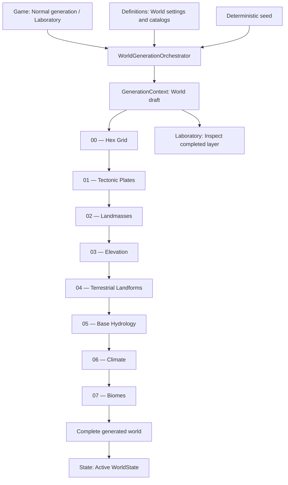
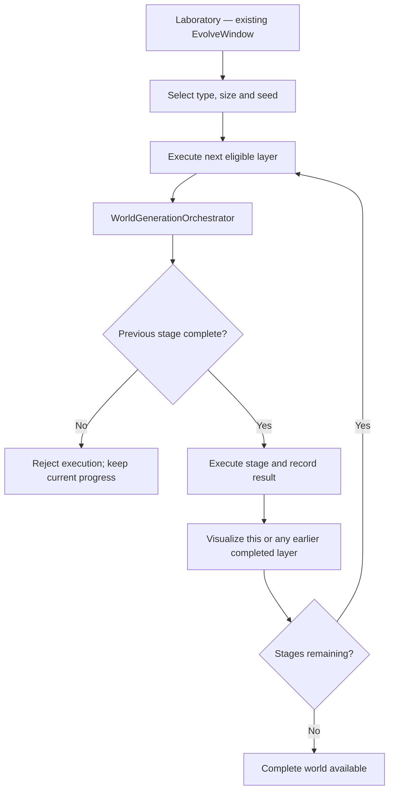
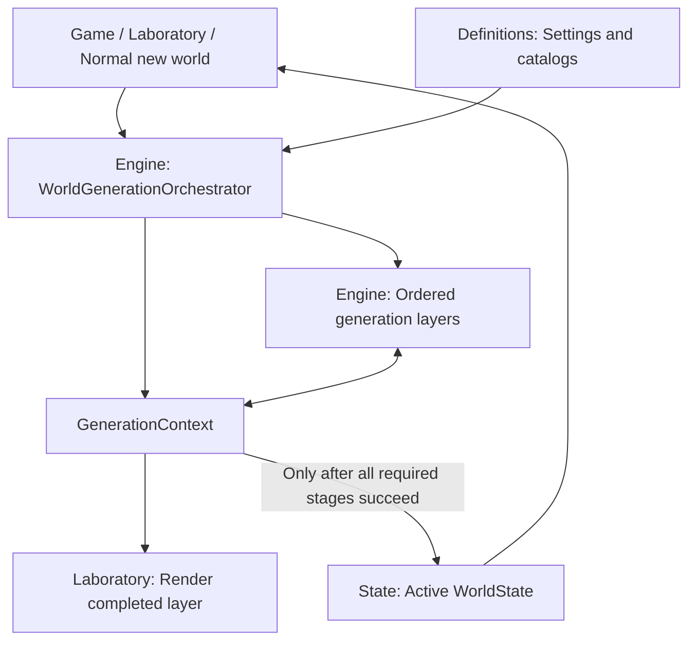

# Evolve — World Generation Architecture

**Repository:** `fgabo404/Evolve`  
**Working branch:** `world`  
**Status:** APPROVED PRELIMINARY DESIGN — implementation not yet authorized  
**Design approved:** 2026-11-18  
**Relationship:** Extends the logical module boundaries in `architecture.MD` without replacing them.

## 1. Purpose and scope

Evolve will generate explorable, hex-cell worlds through a staged, geographically coherent pipeline. Each layer derives information from the results of earlier layers. The same generation engine supports normal world creation and a step-by-step **Laboratory** inside the existing single `EvolveWindow`.

The generator is designed around plausible real-world tectonic, geographic, hydrologic and climatic relationships. World generation belongs to `engine/`; visualization and player interaction belong to `game/`. World creation is distinct from simulation and saved-game persistence.

This document records the approved preliminary architecture and identifies unresolved design decisions. It is **not** an implementation roadmap, a request to create all proposed files, or authorization to develop a layer.

## 2. Approved architectural decisions

1. A single **`WorldGenerationOrchestrator`** is the entry point and coordinator for the generation pipeline. It manages ordering, prerequisites, progression and results; it does not implement the geological algorithms itself.
2. A **`GenerationContext`** represents the world *under construction*. It holds settings, seed, intermediate layer data and completion state. It is not the active `WorldState` or a saved game.
3. A **Laboratory** provides step-by-step execution and visualization of the *same pipeline*. It does not have a separate generator.
4. **Strict prerequisites:** stage N cannot execute until its required preceding stages have completed successfully. In the Laboratory the user can execute **only the next pending stage**, not jump ahead.
5. All game screens, including the future Laboratory, appear in the **existing single window**, not additional OpenTK windows.
6. Files follow the existing repository boundaries: `definitions/`, `engine/`, `state/`, `game/` and `tests/`. Simulation rules never move into the UI.

**Key distinction:** viewing a previously generated layer is allowed at any time; *executing* a later layer without its prerequisites is forbidden.

## 3. Main generation pipeline



Each arrow in the layer chain represents a prerequisite. A stage receives the accumulated world draft, validates the data it requires, computes its own data and records successful completion.

The pipeline order is the approved preliminary plan. Any later refinement of hydrology following climate must be explicitly designed as part of a stage or a new authorized stage; do not introduce a hidden circular execution dependency.

## 4. Stages, inputs and outputs

| Stage | Main inputs | Expected output |
| --- | --- | --- |
| **00 — Grid** | Map size, topology, coordinate rules | Hex cells, identifiers, six-neighbor topology, geographic positions, horizontal wrap |
| **01 — Tectonics** | Grid, tectonic settings, seed | Plate assignment, boundaries, relative movement and crust information |
| **02 — Landmasses** | Grid, plates, selected world type | Land/ocean classification; major landmass groups, islands and coastlines |
| **03 — Elevation** | Tectonics, land/ocean regions | Physical elevation/bathymetry and normalized elevation values |
| **04 — Landforms** | Elevation, plate interactions | Mountain ranges, sierra systems, faults, valleys and other landform classifications |
| **05 — Base hydrology** | Topography, drainage directions, landforms | Watersheds, preliminary drainage network, candidate rivers and lakes |
| **06 — Climate** | Latitude, elevation, land/ocean, terrain and hydrologic context | Temperature, humidity, precipitation, winds and climatic distributions |
| **07 — Biomes** | Climate plus geographic and hydrologic results | Per-cell biome classification and biome distributions |

A stage cannot overwrite unrelated data without an agreed contract. Intermediate outputs must remain inspectable by the Laboratory.

### 4.1 Grid and traversal

- Hexagonal cells with six adjacency directions.
- World navigation and movement inspired by *Civilization V*: continuous horizontal navigation, including crossing the east/west seam.
- The left and right edges connect; north and south retain polar boundaries rather than wrapping into each other.
- Neighbor lookup, distance calculations, plate regions and continent connectivity must respect the horizontal seam.
- The proposed map projection is a **2:1 equirectangular world representation** (360 degrees longitude by 180 degrees latitude). Its exact mapping to hex rows/columns, high-latitude distortion treatment and traversal rules need a dedicated design decision.
- Three map sizes: **Small, Medium and Large**. Exact cell dimensions, resolutions and performance budgets remain undecided.

The grid is not merely a drawn overlay; it is the shared spatial substrate for every generation layer.

### 4.2 Tectonic plates

- Target **10–14 tectonic plates**, with visibly different sizes and irregular boundaries.
- Per-plate information may include identifier, cell region, movement direction, movement speed and crustal composition/regions.
- Boundaries distinguish convergent, divergent and transform interactions.
- Tectonics precede the definitive land/ocean distribution and must influence subsequent continental and relief generation.
- Avoid treating each plate as entirely continental or entirely oceanic unless a later geological model justifies that simplification.
- The exact partitioning algorithm, plate-size distribution and geological parameters remain to be designed.

### 4.3 World types and landmasses

The same orchestrated pipeline supports four world-generation configurations:

1. **Pangea / Supercontinent:** one connected principal landmass.
2. **Continents:** 2–4 principal continental landmasses.
3. **Archipelagos:** groups and chains of islands, islets, cays and related marine geography.
4. **Real Earth:** an Earth-based global geographic distribution, preferably sourced from real geographic reference data rather than expecting procedural randomness to reproduce Earth exactly.

World type constrains landmass topology and geographic distribution; it does not disable tectonic plausibility. Landmass connectivity checks must account for the east/west seam. Definitions of minimum feature size, island classification and coastline algorithms remain pending.

Reefs should not be finalized solely by this landmass stage: their ecological/marine conditions may require later environmental data.

### 4.4 Elevation and terrestrial landforms

- Keep a **physical elevation** value in meters for each cell, including negative values for submarine depth where applicable.
- Provide a separate **normalized elevation** representation from 0 to 100 for agreed classifications and visualization.
- Use tectonic interactions, landmass configuration and regional terrain processes to shape mountains, lowlands and ocean-floor structure.
- The mapping between meters and 0–100 is **not yet approved**. In particular, a linear 0–3,000 m to 0–100 mapping gives 2,500 m a normalized value of about 83.3, **not 50**. A 2,500 m → 50 mapping would correspond to a 5,000 m maximum if linear. Avoid silently choosing one.
- The landforms stage identifies coherent named/classified features such as cordilleras, sierras, faults and valleys from the established geology and terrain; it must not arbitrarily place features without reference to those inputs.

### 4.5 Hydrology, climate and biome dependencies

- **Base hydrology** establishes possible runoff routes and drainage basins using topography.
- **Climate** determines temperature and moisture-related conditions, including precipitation and relevant geographic influences such as latitude, altitude, marine proximity, winds and rain shadows.
- A realistic **final river discharge / lake water balance** also depends on precipitation and evaporation. The treatment of this feedback must be designed explicitly while retaining strict forward stage execution; no implicit loop from climate back to stage 05 is approved.
- **Biomes** are classified last based on climate, elevation, moisture, terrain and water availability. Their placement must be a consequence of previous layers, not an arbitrary first-pass distribution.
- Exact climate seasonality, final hydrology sequencing and biome rules remain subject to separate design.

## 5. Orchestrator responsibilities and progression rules

The `WorldGenerationOrchestrator`:

- Accepts approved generation settings, world type and seed.
- Creates or resumes a `GenerationContext`.
- Knows the ordered stage list and validates prerequisites before execution.
- Executes stages in order, records completion/failure and returns partial or completed results.
- Exposes the latest successfully completed stage and eligible next action to its caller.
- Keeps normal generation and Laboratory execution consistent; neither caller may bypass prerequisites.
- Supports deterministic replay from the same seed, settings, algorithm versions and execution order, subject to later determinism requirements.
- Never owns OpenGL, window input, rendering, player save files or UI message composition.

### Execution modes

| Mode | Intended use | Contract |
| --- | --- | --- |
| **Full generation** | Normal new-world creation | Run every stage in sequence; stop/report on failure |
| **Next stage** | Laboratory | Execute precisely the next eligible stage |
| **Run until stage** | Engine automation/testing | Sequentially execute all prerequisites, never skip them |
| **Rebuild from stage** | Laboratory iteration/testing | Invalidate the edited stage and all downstream stages, then rerun **in order** as requested |

**Strict rule:** “Run single stage” never means “run any stage in isolation.” It means execute the **next eligible** stage, or re-execute an explicitly invalidated stage with valid earlier results.

A rebuild of tectonics cannot retain the old continents, elevations, hydrology, climate or biomes as if they were still valid. Any storage/checkpoint strategy must enforce this invalidation.

## 6. GenerationContext, intermediate state and results

The `GenerationContext` is a temporary world draft with conceptual responsibility for:

- Immutable generation request metadata: seed, world type, map size and relevant settings.
- Shared grid and per-stage data (plates, landmasses, elevations, landforms, hydrology, climate and biomes).
- Stage completion status, dependency validity and errors.
- Inspectable outputs/checkpoints that allow the Laboratory to display an already executed stage.
- A finalization boundary for producing a complete world for `state/`.

Intermediate **generation checkpoints** are not the same thing as the saved-game snapshots defined in `architecture.MD`. Their storage, memory budget, deep-copy semantics and persistence are not yet decided. No player save system is implemented by this design.

Partial worlds stay in the generation context and should not silently become a playable active world. Only a successfully completed world is eligible for integration with the active `WorldState`.

## 7. Laboratory behavior

The Laboratory is a **step-by-step world-generation interface**, not simply a viewer of a fully finished world:

1. The user configures world type, size and seed.
2. The next available action is **Generate Grid (00)**.
3. When the grid succeeds, **Generate Tectonic Plates (01)** becomes available.
4. Each success unlocks only the next stage, through **Biomes (07)**.
5. Already generated layers remain selectable for inspection and comparison, including overlays as a future UI design.
6. If an earlier stage or its settings change, dependent later results are invalidated; any regeneration proceeds sequentially.
7. The Laboratory displays progress and errors reported by the orchestrator; it does not compute generation rules itself.



The Laboratory may use the same window's existing rendering infrastructure, but navigation, layer selection and rendering adapters must remain outside `engine/`.

## 8. Proposed physical folder and file organization

This is an **approved preliminary directory design**, not authorization to create empty folders, placeholder classes or new .NET projects.

```text
Evolve/
├── architecture.MD
├── WORLD_GENERATION_ARCHITECTURE.md
├── VERSION
├── definitions/
│   └── worldgen/
│       ├── WorldGenerationSettings.cs
│       ├── WorldType.cs
│       └── MapSize.cs
├── engine/
│   └── worldgen/
│       ├── WorldGenerationOrchestrator.cs
│       ├── GenerationContext.cs
│       ├── GenerationStage.cs
│       └── layers/
│           ├── grid/
│           ├── tectonics/
│           ├── landmasses/
│           ├── elevation/
│           ├── landforms/
│           ├── hydrology/
│           ├── climate/
│           └── biomes/
├── state/
│   └── world/
│       └── WorldState.cs
├── game/
│   ├── EvolveWindow.cs
│   ├── menu/
│   ├── rendering/
│   └── laboratory/
│       ├── WorldLaboratoryScreen.cs
│       └── LayerVisualization.cs
└── tests/
    ├── menu/
    └── worldgen/
```

Existing files are omitted from this illustrative tree. Names are candidates until each module's contracts are designed.

### Module responsibilities

| Module | Responsibility |
| --- | --- |
| `definitions/worldgen/` | World types, map-size options and generation parameters |
| `engine/worldgen/` | Orchestration, context, stage execution and pure generation algorithms |
| `engine/worldgen/layers/` | One focused directory for each geographical layer |
| `state/world/` | The completed world's representation in the single active game |
| `game/laboratory/` | Stage controls and visualization, within the one existing window |
| `tests/worldgen/` | Stage, topology, determinism and dependency tests without a GPU |

The precise assembly/project boundaries and cross-module contracts are **not yet defined**. Keep the current `game/` project stable unless a later authorized stage requires changes.

## 9. Communication between modules



This diagram represents responsibilities and information flow, **not mandatory direct .NET project references**. In particular, `engine/` must not reference UI or OpenGL types. `state/` remains separate from saved-game storage in `saves/`.

## 10. Validation principles

Every stage requires explicit invariants and tests before proceeding:

- **Grid:** unique cells, valid six-neighbor topology, correct horizontal seam and polar boundaries.
- **Plates:** every cell has a plate assignment; contiguous regions and boundary relationships meet the eventual plate contract.
- **Landmasses:** requested world type is satisfied; Pangea has one connected principal landmass and Continents has 2–4 principal masses, using seam-aware connectivity.
- **Elevation:** physical and normalized values respect the chosen conversion and maintain valid land/sea classifications.
- **Landforms:** geographic features are consistent with terrain and tectonic evidence.
- **Hydrology:** drainage topology and basin connectivity are internally coherent; no unjustified uphill flows.
- **Climate:** values are reproducible and respond plausibly to latitude, elevation, geography and moisture sources.
- **Biomes:** per-cell assignments satisfy the final biome/environment definitions.
- **Orchestration:** no later stage can run early; completion, failure, resumption and downstream invalidation are testable.
- **UI:** Laboratory stage controls reflect actual orchestrator eligibility; rendering never creates simulation state.

Testing should work without creating an OpenTK window or GPU context where feasible.

## 11. Open decisions — do not silently implement

The following points require separate discussion and owner approval:

1. Exact grid dimensions and cell counts for **Small / Medium / Large**, and globe-to-hex projection rules.
2. Hex coordinate system, physical scale, distances and handling of polar distortion.
3. Plate-region generation algorithm, size distribution, crust model and movement parameters.
4. Quantitative land/ocean coverage and connectivity criteria for all four world types.
5. Sources, resolution, licensing and adaptation method for **Real Earth** geography.
6. Exact meters-to-0–100 elevation mapping, bathymetry and overflow/clamping rules.
7. Landform classification thresholds and connected-feature identification.
8. How climate-dependent discharge and lakes are finalized without violating stage order.
9. Climate time resolution, wind/moisture model and biome-classification rules.
10. Intermediate result/checkpoint representation, memory/performance budgets and error recovery.
11. Formal orchestrator/context/stage contracts, .NET assembly boundaries and Laboratory presentation controls.
12. Concrete stage-by-stage implementation roadmap and acceptance tests.

## 12. Development governance and next design steps

This architecture is approved **as a preliminary design only**. No generation implementation, new feature, new screen, physical folder creation or next roadmap has yet been authorized.

Recommended design order:

1. Define the `WorldGenerationOrchestrator` contract and the stage transition/invalidation rules.
2. Define the `GenerationContext` data ownership and the intermediate-result boundary.
3. Specify **Stage 00 — Hex Grid**: projection, three map sizes, coordinates, neighbors and wrap.
4. Define later layers **one at a time**, approving their contracts and validations before implementation.

All future source code must follow root `AGENTS.md`, including English `//` file-purpose headers. Development prompts and project-owner communication remain in Spanish. Future authorized commits must increment root `VERSION`; the working branch for this world-generation initiative is `world`.

**Current outcome:** a documented, approved preliminary architecture for planning; implementation has not begun.
