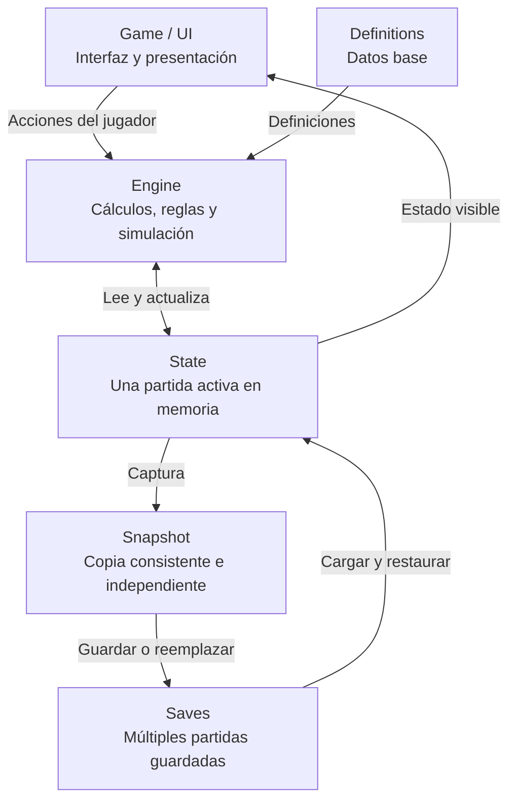
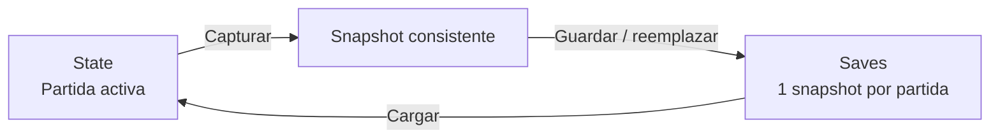

# Evolve — Arquitectura base

**Estado:** decisiones conceptuales aprobadas por el responsable del proyecto.  
**Repositorio:** `fgabo404/Evolve`  
**Rama de trabajo:** `architecture`  
**Documento:** `architecture.MD`  
**Última revisión:** 2026-11-16

## 1. Propósito

Definir la arquitectura lógica inicial de **Evolve**, videojuego de simulación desarrollado en **C# y .NET**, para reconstruir el sistema progresivamente, comenzando por la generación de mundos.

La arquitectura separa definiciones, lógica de simulación, estado activo, persistencia y presentación. Este documento establece responsabilidades y principios; **no impone todavía una estructura física de proyectos, carpetas, clases o interfaces**.

## 2. Componentes aprobados

| Componente | Responsabilidad principal | Fuera de su responsabilidad |
| --- | --- | --- |
| **Definitions** | Contener los datos base, catálogos y parámetros del juego (por ejemplo, biomas, recursos, especies y tecnologías). | Guardar el progreso o los cambios particulares de una partida. |
| **Engine** | Consumir definiciones, generar mundos y ejecutar cálculos, reglas y simulaciones sobre la partida activa. | Administrar archivos de guardado o contener la interfaz gráfica. |
| **State** | Representar y mantener **una sola partida activa en memoria**, con el estado actual del mundo y de sus entidades. | Conservar un historial de partidas guardadas o encargarse del almacenamiento físico. |
| **Saves** | Administrar múltiples partidas guardadas; guardar y recuperar la representación persistente de cada una. | Ejecutar las reglas de simulación. |
| **Game / UI** | Presentar gráficos, menús y estado visible; recibir las acciones del jugador. | Implementar reglas de simulación. |

## 3. Diagrama funcional

> **Nota:** el diagrama representa flujos y responsabilidades, **no** referencias obligatorias entre proyectos .NET. Las dependencias de código se definirán posteriormente.

## 4. Principios arquitectónicos aprobados

1. **Definitions** contiene información base, **no** el progreso del jugador.
2. **State** mantiene **una sola partida activa** en memoria.
3. **Saves** puede contener **múltiples partidas guardadas**.
4. **Engine** no necesita saber **dónde ni cómo se almacenan físicamente** las partidas.
5. **Game / UI** no contiene reglas de simulación.

**Separación adicional:** el motor de simulación y generación (`Engine`) es distinto de la representación gráfica (`Game / UI`). La simulación debe poder funcionar sin iniciar la interfaz.

## 5. Estado activo y persistencia

### 5.1 State

- Es la fuente del estado **actual** de la partida en ejecución.
- Cambia a medida que `Engine` aplica reglas, cálculos y acciones.
- Puede representar, según las mecánicas que se desarrollen, terreno, biomas, condiciones ambientales, entidades, progreso y tiempo de simulación.
- Solo mantiene **una** partida activa a la vez.

### 5.2 Saves

- Gestiona la lista de partidas guardadas.
- Guarda el estado de la partida seleccionada y permite recuperarlo.
- Al cargar una partida, restaura su información como la nueva partida activa de `State`.
- La ubicación física, el formato de archivos y el mecanismo de serialización **no están definidos todavía**.

### 5.3 Snapshot: decisión aprobada

**Regla principal: un único snapshot por partida guardada (opción A).**

Un *snapshot* es una representación de los datos necesarios para recuperar el estado de una partida en un instante dado. **No es una imagen del mapa**.

- La captura debe corresponder a un punto **consistente** de la simulación.
- Una vez capturado, el snapshot debe ser **independiente del estado activo**: los cambios posteriores de `State` no alteran lo que se guardó.
- **Cada nuevo guardado reemplaza el snapshot anterior de esa misma partida**.
- Distintas partidas pueden tener cada una su snapshot.
- **No habrá historial de snapshots ni recuperación de versiones antiguas** en esta fase.
- El reemplazo del guardado debe ser seguro para evitar perder la última versión válida si ocurre un fallo.

La captura y el almacenamiento se consideran responsabilidades diferentes; aún no se decide cómo se implementarán ni si se harán de forma síncrona o asíncrona.

## 6. Flujos principales

### Crear mundo

1. `Game / UI` recibe la solicitud del jugador.
2. `Engine` utiliza `Definitions` y genera el mundo.
3. El resultado pasa a ser la única partida activa en `State`.
4. `Game / UI` presenta el estado visible.

### Simular

1. `Game / UI` comunica las acciones del jugador.
2. `Engine` aplica las reglas de simulación sobre `State` utilizando las definiciones necesarias.
3. `Game / UI` refleja el estado actualizado, sin implementar las reglas de juego.

### Guardar

1. Se obtiene de `State` un snapshot consistente e independiente.
2. `Saves` persiste el snapshot de la partida correspondiente.
3. Si esa partida ya estaba guardada, el snapshot anterior se reemplaza de forma segura.
4. `State` continúa siendo la partida activa; guardar no cambia sus reglas de simulación.

### Cargar

1. El jugador selecciona una partida disponible en `Saves`.
2. `Saves` recupera el snapshot correspondiente.
3. Su información se restaura en `State`, que pasa a representar esa partida como la única activa.
4. `Game / UI` presenta el estado restaurado.

## 7. Alcance y decisiones pendientes

Esta arquitectura está **aprobada a nivel lógico**, pero quedan pendientes de discusión y autorización:

- Estructura real de carpetas, proyectos y ensamblados .NET.
- Contratos e interfaces entre componentes.
- Modelos de datos, gestión del tiempo y organización interna del motor.
- Formato, ubicación y versionado de los archivos de guardado.
- Estrategia técnica de captura consistente y escritura segura.
- Tecnología y organización interna del renderizado y la interfaz.

No se deben introducir estas decisiones como si estuvieran aprobadas.

## 8. Gobierno del proyecto

- **Arquitecto:** analiza, diseña y propone.
- **Dev:** implementa lo autorizado.
- **Auditor:** verifica calidad y cumplimiento.
- **Responsable del proyecto:** aprueba las decisiones y los cambios.

El diseño se aborda **un tema a la vez**. No se implementa, reorganiza código ni modifica el roadmap sin autorización expresa.

---

**Estado de este documento:** registro inicial de los acuerdos alcanzados; sujeto a revisión cuando el responsable del proyecto apruebe nuevas decisiones.
