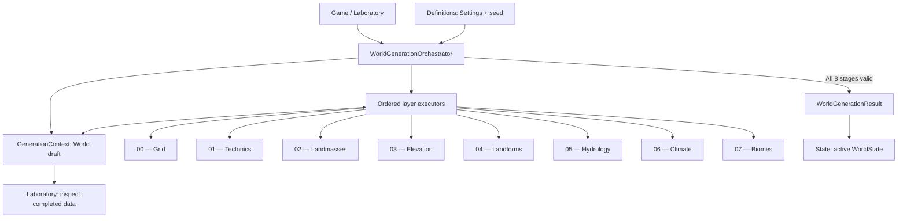
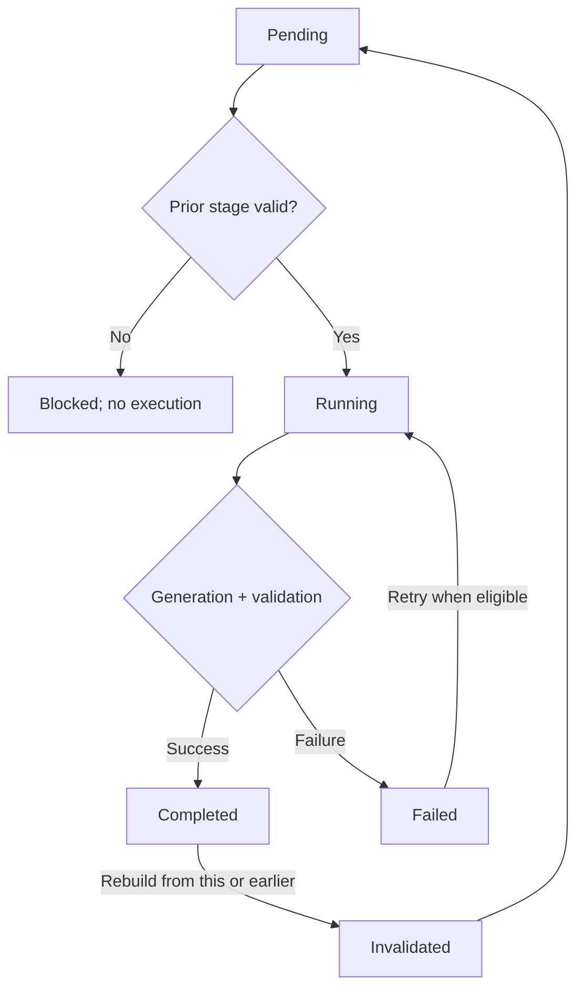

# Evolve — WG-CORE: Orchestrator and Generation Context

**Repository:** `fgabo404/Evolve`  
**Integration branch:** `world`  
**Implementation branch:** `world-core`\
**Design status:** APPROVED BY PROJECT OWNER — 2026-11-18  
**Implementation status:** CORE-01 through CORE-05 accepted; WG-CORE closed — 2026-11-18  
**Audit status:** APPROVED; prior documentation observations resolved — 2026-11-18  
**Parent documents:** [World Generation Architecture](../../WORLD_GENERATION_ARCHITECTURE.md) · [General Roadmap](roadmap.md)
**Technical artifacts:** [Approved technical design](core-contracts.md) · [Approved WG-CORE roadmap](core-roadmap.md)

## 1. Purpose and architectural boundary

WG-CORE defines the common execution contract for Evolve's eight-stage world-generation pipeline. A **single `WorldGenerationOrchestrator`** coordinates execution, while **`GenerationContext`** holds the world being built and the validated intermediate outputs. Stage algorithms remain in `engine/worldgen/layers/`; presentation remains in `game/laboratory/`.

Normal generation and Laboratory generation **must use the same orchestrator and layer implementations**. Laboratory generation advances one stage at a time and can inspect every previously completed stage. The core remains independent of OpenTK, the UI, GPU rendering and save-file storage.

### Logical diagram



This shows information flow and responsibilities, not required assembly references. The `layers/` directory is a conceptual ordered set of executors, not eight independent generation engines.

## 2. WorldGenerationOrchestrator — functional contract

The orchestrator owns the stage registry/order, eligibility checks, execution lifecycle, success/failure status, downstream invalidation and finalization eligibility. It **does not** generate grid cells, tectonic plates, terrain, rivers, climate or biomes itself.

| Proposed operation | Contract |
| --- | --- |
| `CreateGeneration()` | Create a generation session/context from validated settings and main seed. |
| `RunNext()` | Execute **exactly the next eligible** unfinished stage. Laboratory's forward-execution entry point. |
| `RunAll()` | Run remaining stages in order; stop on failure. Uses the same stage execution path as `RunNext()`. |
| `RunUntil(stage)` | Execute all outstanding prerequisites and stages sequentially up to a target; intended for automation/tests, not Laboratory skipping. |
| `RebuildFrom(stage)` | Invalidate the chosen stage **and every downstream stage**, preserving only earlier valid results; subsequent execution stays sequential. |
| `GetProgress()` | Return per-stage states, latest completed stage, next eligible stage, and relevant error information. |
| `GetLayerData(stage)` | Expose **read-only** results for a successfully completed, non-invalidated stage. |
| `FinalizeWorld()` | Produce a complete world result only after all eight stages have completed and passed validation. |

These operation names describe the **approved functional design**. Implemented C# signatures, return types and error models are recorded in [technical contracts](core-contracts.md); cancellation and async semantics remain outside the implemented scope.

### Execution modes and entry-point rules

- **Normal world generation:** `RunAll()`, using the identical ordered layer pipeline.
- **Laboratory:** only `RunNext()` is used for forward progression; the user may not select a later stage for execution.
- **Automated runs/tests:** `RunUntil(stage)` progresses through all prerequisites rather than bypassing them.
- **Iteration:** `RebuildFrom(stage)` invalidates that stage and its dependents; any rerun is again in order.
- **Inspection is separate from execution:** viewing Grid while Climate is already complete does not alter completion or generation state.

No operation may grant execution eligibility merely because a UI button was enabled. The orchestrator revalidates prerequisites independently.

## 3. Stage lifecycle and safety guarantees



Stage states are `Pending`, `Running`, `Completed`, `Failed` and `Invalidated`; `Blocked` is a **rejected operation**, not a persisted stage completion state.

The following invariants are approved:

1. **Strict order.** Stage `N` requires the successful, valid completion of preceding stage `N - 1` in the **same** `GenerationContext`; the first stage is Grid (00).
2. **Atomic publication.** A failed stage must not publish partial or unvalidated data into the context or corrupt earlier completed data. Failed results cannot unlock a later stage.
3. **Downstream invalidation.** Rebuilding stage `N` invalidates `N` through stage 07. No old downstream result may be treated as current.
4. **Single active execution per context.** Simultaneous stage executions must be rejected or serialized so they cannot mutate the same world concurrently.
5. **Read-only completion.** Later layers consume earlier validated outputs without modifying the owners' data in place.
6. **Finalization gate.** Only a world with all eight stages completed and validated can produce a final world result for `state/world/`.

At design approval, atomic-result storage, cancellation, retry behavior and data memory budgets were implementation decisions. The implemented storage and retry contracts are recorded in [technical contracts](core-contracts.md); cancellation and data memory budgets remain outside the implemented scope.

## 4. GenerationContext — logical contract

The `GenerationContext` is **temporary generation state**, separate from the one active `WorldState` and from saved-game snapshots in `saves/`.

| Conceptual section | Contents | Ownership |
| --- | --- | --- |
| **GenerationMetadata** | Generation ID, seed, map size, world type, approved settings, relevant generator version metadata | Fixed for one generation session, except through an explicitly defined rebuild/reset workflow |
| **LayerProgress** | Stage status, last completed stage, next eligible stage, execution errors | Orchestrator-controlled; not UI-maintained |
| **LayerData** | GridData, TectonicData, LandmassData, ElevationData, LandformData, HydrologyData, ClimateData, BiomeData | Published by their corresponding stage only after validation |

These data names are **conceptual**, not a commitment to eight concrete class names.

### Ownership and memory principles

- Each stage publishes its own data **indexed to the shared hex-grid identity**, where applicable.
- Reuse grid/cell identifiers instead of copying the entire map after every stage.
- Completed data is exposed to later layers and Laboratory presentation as **read-only**.
- Intermediate results stay inspectable while valid. They are not automatically persisted as game saves.
- Full snapshots, checkpoint persistence, structural sharing, deep copies, memory limits and cleanup policies were unspecified at design approval. Implemented immutable buffer ownership and finalization snapshot contracts are recorded in [technical contracts](core-contracts.md); other items remain outside the implemented scope.
- Partial data is **not** silently promoted into `WorldState`.

### Conceptual data flow

```mermaid
sequenceDiagram
    participant Lab as Laboratory
    participant Orch as Orchestrator
    participant Ctx as GenerationContext
    participant Layer as Next layer executor
    Lab->>Orch: RunNext()
    Orch->>Ctx: Check next stage and prerequisites
    Orch->>Layer: Execute using validated inputs
    Layer-->>Orch: Candidate output or failure
    Orch->>Orch: Validate candidate output
    alt Success
        Orch->>Ctx: Publish output + Completed
        Orch-->>Lab: Updated progress
    else Failure
        Orch->>Ctx: Record failure; preserve valid outputs
        Orch-->>Lab: Failure; next stage locked
    end
    Lab->>Ctx: Inspect completed layer (read-only)
```

This is a **logical** sequence. It does not prescribe direct mutable access from the UI or the final internal C# API.

## 5. Determinism and rebuilding

**Guarantee:** same main seed, same settings, same algorithm versions and the same valid execution inputs must reproduce the same world, regardless of whether stages were run by `RunAll()` or sequential `RunNext()` calls.

The approved random-stream design derives **stage-specific deterministic streams** from the main seed and stage identity. This prevents consuming random values in one stage from accidentally shifting unrelated stages' random sequences.

For example:

```text
WorldSeed
├── GridSeed
├── TectonicsSeed
├── LandmassesSeed
├── ElevationSeed
├── LandformsSeed
├── HydrologySeed
├── ClimateSeed
└── BiomesSeed
```

Example: `RebuildFrom(Elevation)` preserves Grid, Tectonics and Landmasses; it invalidates Elevation, Landforms, Hydrology, Climate and Biomes. Changing the main seed, map size or a global setting that affects the grid starts a **new generation session from Grid**.

The seed-derivation function and algorithm-version strategy were pending at design approval. The accepted CORE-04 implementation is documented in [technical contracts](core-contracts.md#16-core-04-deterministic-streams-and-exclusive-rebuild).

## 6. Laboratory integration

The Laboratory will run **inside the existing single `EvolveWindow`**. The UI requests `RunNext()` and renders the results; it does not implement world generation.

- Initially, only **Generate Grid (00)** is eligible.
- When Grid succeeds, only **Tectonics (01)** becomes executable.
- Successfully completed stages can be selected for inspection, even after later stages exist.
- The UI must reflect the orchestrator's progress and errors rather than maintaining a second independent set of stage states.
- The UI may request rebuilding an earlier stage through the orchestrator, which invalidates its dependent stages.
- A generated world is eligible for finalization only after Biomes (07) completes.

Laboratory overlays, navigation design, renderer classes and interactive controls are outside WG-CORE's implementation scope.

## 7. Planned source organization

The following is the **historical candidate source organization**, preserved from design approval. It is not the current file inventory; approving the design itself created no C# file, interface or project. Implemented types and project boundaries are recorded in [technical contracts](core-contracts.md).

```text
engine/worldgen/
├── WorldGenerationOrchestrator.cs
├── GenerationContext.cs
├── GenerationStage.cs
├── GenerationProgress.cs
├── GenerationResult.cs
├── IWorldGenerationLayer.cs
├── core-architecture.md
├── readme.md
├── roadmap.md
└── layers/
    ├── grid/
    ├── tectonics/
    ├── landmasses/
    ├── elevation/
    ├── landforms/
    ├── hydrology/
    ├── climate/
    └── biomes/
```

Implemented class/interface decomposition and method signatures are recorded in the WG-CORE implementation contract. New C# files must follow the English `//` file-purpose comment policy in `AGENTS.md`.

## 8. WG-CORE acceptance criteria

WG-CORE can be accepted only after tests and technical review demonstrate:

1. Tectonics cannot run before Grid, and no stage can skip a prerequisite.
2. A failed layer leaves prior completed output intact and never unlocks the next layer.
3. `RunAll()` and eight valid sequential `RunNext()` executions produce equivalent results for the same seed/settings and algorithm versions.
4. Rebuilding an earlier layer invalidates all dependent outputs.
5. Completed outputs remain available for read-only inspection.
6. The engine executes and can be validated **without OpenTK or GPU dependencies**.
7. `FinalizeWorld()` fails or remains unavailable until every stage is valid.

These criteria preserve the original validation gates; the design approval itself supplied no execution evidence. CORE-01 through CORE-04 are now accepted and CORE-05 is implemented. The independent audit subsequently reported **APPROVED**, previous documentation observations were resolved, and the owner formally accepted CORE-05 and WG-CORE. Implementation evidence is recorded in the [technical contracts](core-contracts.md) and [core roadmap](core-roadmap.md).

## 9. Remaining engineering decisions

At original approval, the design did **not determine**: exact C# API signatures; settings DTOs and dependency direction between assemblies; stage result representation; resource ownership/copy semantics; concurrency primitives; cancellation and asynchronous execution; failure recovery details; checkpoint storage; exact derivation of stage seeds; internal event/progress notification mechanism; or user-interface layout. Implemented API, project boundaries, immutable ownership, concurrency, retry and deterministic seed derivation are now recorded in [technical contracts](core-contracts.md). The remaining items are outside the implemented WG-CORE scope.

The owner has **accepted CORE-01 through CORE-05 and formally closed WG-CORE** on `world-core` following the independent auditor's **APPROVED** verdict. Previous documentation observations are resolved. Integration into `world`, WG-00 and any subsequent work require separate explicit authorization.

**WG-CORE formally accepted and closed. Audit APPROVED. Integration not authorized.**
