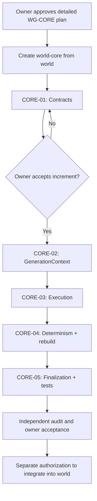

# Evolve — WG-CORE Implementation Roadmap

**Repository:** `fgabo404/Evolve`  
**Integration branch:** `world`  
**Planned working branch:** `world-core` (not created)  
**Status:** DRAFT FOR OWNER APPROVAL — no implementation authorized  
**Approved design:** [WG-CORE architecture](core-architecture.md)  
**Proposed engineering contract:** [WG-CORE technical contracts](core-contracts.md)

## Objective

Build and verify the **generation control core only**: one orchestrator, a temporary generation context, a strict eight-stage contract, deterministic execution and rebuild/invalidation. It must remain usable without a graphical window.

No hex-grid algorithm, real-world tectonics, landmass generator, elevations, hydrology, climate, biome logic, Laboratory screen or playable world creation is in this roadmap.

## Small, independently gated implementation increments

| Increment | Scope | Evidence / exit gate | Status |
| --- | --- | --- | --- |
| **CORE-01 — Contract foundation** | Approve exact contracts, stage identities, generation request shape and minimal headless project/test organization; register eight test-only executors | Stage registry validates order/identity; builds without GPU; owner-approved C# API | Not started |
| **CORE-02 — GenerationContext** | Immutable request metadata, per-stage output ownership, read-only inspection and stage progress states | No mutability leak; no partial or invalidated outputs visible; test-only data accepted | Not started |
| **CORE-03 — Orchestrator execution** | `CreateGeneration`, `RunNext`, `RunUntil`, `RunAll`; prerequisite validation, atomic publication, failure and retry | No skipped stages; no invalid commit; all entry modes share one execution path | Not started |
| **CORE-04 — Determinism and rebuild** | Stage-specific seeded streams, one active execution per context, `RebuildFrom` and downstream invalidation | Same seed/settings yield same output across modes; rebuilding N removes N..07 | Not started |
| **CORE-05 — Finalization and verification** | `FinalizeWorld` as complete-result boundary; unit/contract tests; verification and developer/auditor evidence | Completed eight stages only; headless tests and Release build; accepted review | Not started |

**Execution rule:** work on only the individually authorized increment. Do not advance from CORE-01 to CORE-02 merely because its code is complete; wait for explicit owner approval.

## Proposed delivery flow

Every increment receives its own test evidence and accepted Git commit, with root `VERSION` incremented according to `AGENTS.md`. No automatic merge, branch deletion or next-layer development is implied.

## Key architectural gates

- Only the orchestrator can publish validated output or mutate progress.
- Stage N cannot run before stage N-1 completes in the same context.
- The Laboratory can call only `RunNext()` for forward execution and inspect completed layers.
- `RunAll()`, `RunUntil()` and `RunNext()` share the same stage execution path.
- Failed output is not published; later stages remain locked; retry respects prerequisites.
- Rebuild invalidates the selected layer and all downstream outputs.
- Finalization requires eight valid completed layers and returns a result, not direct `WorldState` mutation.
- Test-only fake layers are allowed for WG-CORE; no real geographical algorithms are implemented ahead of their layer stage.
- No new native window, UI change, OpenTK dependency or save-game snapshot machinery.

## Verification requirements per increment

- Add/update GPU-independent tests for the increment's invariants.
- Verify actual test results, a Release build and `git diff --check` where applicable.
- Report exactly what ran, any skipped checks and outstanding decisions.
- Confirm only authorized source paths changed; preserve existing menu tests.
- Obtain independent audit and owner approval before final integration into `world`.

## Pending pre-implementation decisions

1. Approve the proposed operation semantics and concrete API/error types.
2. Approve initial .NET project boundaries and dependency direction.
3. Choose how completed data becomes read-only and how atomic publication is implemented.
4. Choose a stable, versioned PRNG and stage-seed derivation strategy.
5. Define cancellation/concurrency detail appropriate to the first implementation.
6. Finalize CORE-01 acceptance tests and minimal file list.

These decisions must be resolved **before or within a separately authorized CORE-01 design gate**, not silently coded as developer assumptions.

**Roadmap status:** planning only; neither `world-core` nor any C# implementation has been created.
