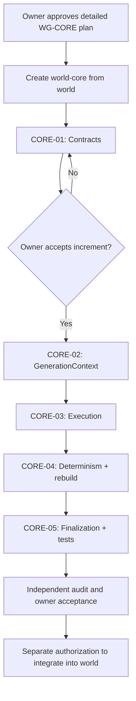

# Evolve — WG-CORE Implementation Roadmap

**Repository:** `fgabo404/Evolve`  
**Integration branch:** `world`  
**Working branch:** `world-core`

**Status:** CORE-01 through CORE-04 accepted; CORE-05 implemented, pending independent audit and final owner acceptance.

**Approved design:** [WG-CORE architecture](core-architecture.md)  
**Proposed engineering contract:** [WG-CORE technical contracts](core-contracts.md)

## Objective

Build and verify the **generation control core only**: one orchestrator, a temporary generation context, a strict eight-stage contract, deterministic execution and rebuild/invalidation. It must remain usable without a graphical window.

No hex-grid algorithm, real-world tectonics, landmass generator, elevations, hydrology, climate, biome logic, Laboratory screen or playable world creation is in this roadmap.

## Small, independently gated implementation increments

| Increment | Scope | Evidence / exit gate | Status |
| --- | --- | --- | --- |
| **CORE-01 — Contract foundation** | Approve exact contracts, stage identities, generation request shape and minimal headless project/test organization; register eight test-only executors | Stage registry validates order/identity; builds without GPU; owner-approved C# API | Accepted by project owner — 2026-11-18 |
| **CORE-02 — GenerationContext** | Immutable request metadata, per-stage output ownership, read-only inspection and stage progress states | No mutability leak; no partial or invalidated outputs visible; test-only data accepted | Accepted by project owner — 2026-11-18 |
| **CORE-03 — Orchestrator execution** | `CreateGeneration`, `RunNext`, `RunUntil`, `RunAll`; prerequisite validation, atomic publication, failure and retry | No skipped stages; no invalid commit; all entry modes share one execution path | Accepted by project owner — 2026-11-18 |
| **CORE-04 — Determinism and rebuild** | Stage-specific seeded streams, one active execution per context, `RebuildFrom` and downstream invalidation | Same seed/settings yield same output across modes; rebuilding N removes N..07 | Accepted by project owner — 2026-11-18 |
| **CORE-05 — Finalization and verification** | `FinalizeWorld` as complete-result boundary; unit/contract tests; verification and developer/auditor evidence | Completed eight stages only; headless tests and Release build; accepted review | Implemented — pending independent audit and owner acceptance |

**Execution rule:** work on only the individually authorized increment. Do not advance from CORE-01 to CORE-02 merely because its code is complete; wait for explicit owner approval.

## Proposed delivery flow

Every increment receives its own test evidence and accepted Git commit, with root `VERSION` incremented according to `AGENTS.md`. No automatic merge, branch deletion or next-layer development is implied.

## Key architectural gates

- Only the orchestrator can publish validated output or mutate progress.
- Stage N cannot run before stage N-1 completes in the same context.
- The Laboratory can call only `RunNext()` for forward execution and inspect completed layers.
- `RunAll()`, `RunUntil()` and `RunNext()` share the same stage execution path.
- Failed output is not published; later stages remain locked; retry respects prerequisites.
- Rebuild invalidates the selected layer and all downstream outputs.
- Finalization requires eight valid completed layers and returns a result, not direct `WorldState` mutation.
- Test-only fake layers are allowed for WG-CORE; no real geographical algorithms are implemented ahead of their layer stage.
- No new native window, UI change, OpenTK dependency or save-game snapshot machinery.

## Verification requirements per increment

- Add/update GPU-independent tests for the increment's invariants.
- Verify actual test results, a Release build and `git diff --check` where applicable.
- Report exactly what ran, any skipped checks and outstanding decisions.
- Confirm only authorized source paths changed; preserve existing menu tests.
- Obtain independent audit and owner approval before final integration into `world`.

## Pending pre-implementation decisions

1. Approve the proposed operation semantics and concrete API/error types.
2. Approve initial .NET project boundaries and dependency direction.
3. Choose how completed data becomes read-only and how atomic publication is implemented.
4. Choose a stable, versioned PRNG and stage-seed derivation strategy.
5. Define cancellation/concurrency detail appropriate to the first implementation.
6. Finalize CORE-01 acceptance tests and minimal file list.

These decisions must be resolved **before or within a separately authorized CORE-01 design gate**, not silently coded as developer assumptions.

**Roadmap status:** approved. CORE-01 was accepted by the project owner on
2026-11-18 following developer test evidence and an architectural source review.
CORE-02 through CORE-04 were accepted by the project owner on 2026-11-18 following
reported headless test results and architectural source reviews. CORE-05 is the
only authorized next increment; final WG-CORE acceptance and merge remain gated.
No merge into `world` or geographic layer development is authorized.

## CORE-01 delivery record

The implemented C# signatures and project-boundary decisions are documented in
[core-contracts.md, section 10](core-contracts.md#10-core-01-implemented-c-contract).
The constructor validates a complete fixed registry; no layer is executed.
Minimal immutable request/settings types contain only the main seed, four world
types and three dimensionless map-size choices. Eight fake layer implementations
are confined to `tests/worldgen/`.

The CORE-01 design gate resolves stage identity/order, request representation,
registration validation exceptions and the checks → engine → definitions
dependency direction (engine references definitions; checks reference engine).
Execution parameters, read-only outputs, atomic publication, operation error
results, context lifecycle, PRNG, concurrency, rebuild and finalization remain
deferred to their separately authorized increments. No placeholder executable
contract is introduced to fill those gaps.

Development evidence: 15/15 CORE-01 checks passed, the existing 16/16 menu checks
passed, engine and game Release builds reported zero warnings/errors, and
whitespace verification passed. The compiled display version is `v0.0.15`.
The commands and coverage are recorded in `core-contracts.md`. This evidence supported the owner's subsequent acceptance; it is **development
validation and architectural source review**, not a new independent audit.
CORE-02 authorization does not authorize later increments.

## CORE-02 delivery record

`GenerationContext` retains immutable request metadata and one private table of
stage status, data and diagnostic records. `GenerationProgress` derives immutable
observations from that table. `LayerData<T>` owns a copied unmanaged value buffer
for one stage and exposes only read-only values; no complete world copy is made
for each stage. The five approved lifecycle states are represented explicitly.

Only restricted engine-internal storage transitions can prepare a slot, publish
matching data, record failure or discard one published result. The existing
headless check assembly receives a named friend grant to test these methods
directly. They are not an orchestrator, prerequisite gate, execution/retry mode
or automatic invalidation system. Calls are not advertised as thread-safe.

Exact signatures, alias-protection constraints and remaining operational scope
are recorded in [CORE-02 contracts](core-contracts.md#12-core-02-context-and-read-only-storage-contract).
CORE-01 contracts remain unchanged. CORE-03 execution, CORE-04 PRNG/rebuild and
CORE-05 finalization are not implemented or authorized by this delivery.

Development evidence: 15/15 CORE-01, 19/19 CORE-02 and 16/16 existing menu checks
passed. Engine and game Release builds completed with zero warnings/errors;
`git diff --check` passed; the compiled display version matched `v0.0.17`.
No GUI, real layer or orchestrator execution was performed. This development
evidence and architectural source review supported the owner's CORE-02 acceptance,
without claiming an independently executed audit.

## CORE-03 authorization record

The owner authorized CORE-03 on 2026-11-18 after accepting CORE-02.
The authorized scope is the single `WorldGenerationOrchestrator` execution path,
`CreateGeneration`, `RunNext`, `RunUntil`, `RunAll`, prerequisite enforcement,
atomic validated publication, failure diagnostics and retry using test-only
executors. No real geographic layer or Laboratory UI is authorized.

The developer must extend the currently identity-only `IWorldGenerationLayer`
with a narrow executable contract while preserving validated stage registration
and CORE-01/02 behaviors. All consumers of a stage's inputs are read-only.
CORE-04's PRNG, operational rebuild/downstream invalidation, and full concurrency
strategy are deferred; CORE-05 finalization is deferred. Acceptance requires
new headless tests and preserved CORE-01/02/menu regression coverage.

## CORE-03 delivery record

`WorldGenerationOrchestrator` now provides synchronous `CreateGeneration`,
`RunNext`, `RunUntil` and `RunAll`. All forward modes share one private stage
runner. Layers receive immutable request metadata and earlier completed buffers
through `GenerationLayerInputs`; they return a `LayerExecutionResult` candidate
or explicit failure. Only validated, correctly owned candidates are published.
Execution failures record Failed without exposing partial data or changing
previous outputs. Bulk modes stop on failure; later calls retry the eligible
failed stage without repeating predecessors. Completed targets/worlds are no-ops.

Running and reentrant attempts, inconsistent completion prefixes and invalidated
drafts are rejected before mutation. Full cross-thread operation exclusivity,
PRNG, operational rebuild/cascade and finalization remain deferred to CORE-04/05.
The public context surface and project dependencies are unchanged. The eight
neutral executors remain exclusively in `tests/worldgen/`; no geographic layer,
UI change or `WorldState` integration is included.

The exact signatures, operation-error policy and scope limits are recorded in
[CORE-03 contracts](core-contracts.md#14-core-03-sequential-execution-contract).
CORE-03 was subsequently accepted by the project owner on 2026-11-18 after
review of its source and reported developer test evidence. CORE-04 is now
authorized as the next increment; no merge into `world` is authorized.

Development evidence for `v0.0.19`: 15/15 CORE-01, 19/19 CORE-02, 17/17 CORE-03
and 16/16 menu checks passed. Both Release builds reported zero warnings/errors,
and whitespace verification passed. The compiled product version and generated
informational version matched root `VERSION`. Environment limitations and exact
execution contracts are recorded in section 14 of the contracts document.
No GUI validation or independent audit acceptance is claimed.

## CORE-04 authorization record

The project owner accepted CORE-03 and authorized CORE-04 on 2026-11-18.
The implementation scope is deterministic per-stage PRNG streams derived from
main seed and stable stage identity; documented stable seed mixing and algorithm
version behavior; `RebuildFrom(stage)` discarding that stage and all downstream
outputs; and real same-context cross-thread operation exclusivity, including
through different orchestrator instances. Existing forward execution modes
must retain their single shared runner, failure isolation and retry semantics.

The CORE-04 implementation must restore execution eligibility after an explicit
rebuild, preserving the valid completed prefix and ensuring no previously
published downstream result can become visible or eligible. Concurrent
operations on a shared context must not interleave, even when initiated through
different orchestrators. Single-stage deterministic reruns must reproduce the
same result under identical versions, settings and prerequisite data.

Use test-only deterministic layer executors and headless tests. Do not implement
real geographic layers, the Laboratory UI, WorldState integration or
`FinalizeWorld` (CORE-05). No integration into `world` is authorized yet.

## CORE-04 delivery record

Implemented versioned SplitMix64 stage streams, per-context cross-instance
operation exclusivity and atomic suffix rebuilding. All forward modes still use
the existing single runner; rebuilt slots resume in canonical order. Exact
signatures, arithmetic, vectors, status policy and observation guarantees are in
[CORE-04 contracts](core-contracts.md#16-core-04-deterministic-streams-and-exclusive-rebuild).
Eight new headless checks complement all 51 previous core checks.
CORE-04 was subsequently accepted by the project owner on 2026-11-18. CORE-05
is authorized as the next increment, without authorizing integration into `world`
or geographic layer development.

Development evidence: 59/59 core checks and 16/16 menu checks passed; both
explicit Release builds reported zero warnings/errors. Whitespace verification
passed and compiled ProductVersion matched v0.0.21. No GUI validation or
independent audit acceptance is claimed.

## CORE-05 authorization record

The owner accepted CORE-04 and authorized CORE-05 on 2026-11-18.
Implement only the completed-generation boundary `FinalizeWorld(context)` and
its immutable `WorldGenerationResult` output, plus headless acceptance/regression
checks. Finalization must require all eight stages to be valid and Completed,
using the context's operation exclusivity and coherent snapshot policy.

No partial, Failed, Running or Invalidated stage may be finalized. A result
must hold immutable completed output buffers and required request/version metadata
without duplicating full world data or modifying active `WorldState`.
Previously finalized results must remain consistent immutable snapshots after a
later rebuild; they are not automatically promoted into active game state.
Repeated finalization should be safe and not generate layers again.

CORE-05 must preserve all CORE-01..04 semantics, verify failure/retry/rebuild
and concurrency boundaries, and document exact signatures and tests. No real
geography, Laboratory UI, `state/world` implementation, persistence or merging
into `world` is authorized. Independent audit and separate owner acceptance
remain required before WG-CORE can be considered finished/integrated.

## CORE-05 delivery record

Implemented `FinalizeWorld(context)` and immutable `WorldGenerationResult`.
Only eight Completed, available and correctly owned outputs can be captured
under the existing context-wide operation lease. Finalization changes no context
state and runs no layer. The result owns a small reference table, sharing
immutable buffers and request metadata; historical results survive later
rebuilding and regeneration. The PRNG compatibility identifier is captured
without introducing geographic version metadata or copying the world.

Ten new headless checks complement all 59 existing core checks. The exact API,
errors, ownership and concurrency test limits are documented in
[CORE-05 contracts](core-contracts.md#18-core-05-finalization-contract).
CORE-05 is implemented only; independent audit and final owner acceptance remain
pending. This record does not close or accept WG-CORE, authorize a merge into
world or start geographic, state, saves or UI development.

Development validation for v0.0.23: 69/69 core checks and 16/16 menu checks passed;
engine and game Release builds each completed with zero warnings/errors.
Whitespace checking passed and compiled ProductVersion matched VERSION.
Independent audit and owner acceptance remain pending.
