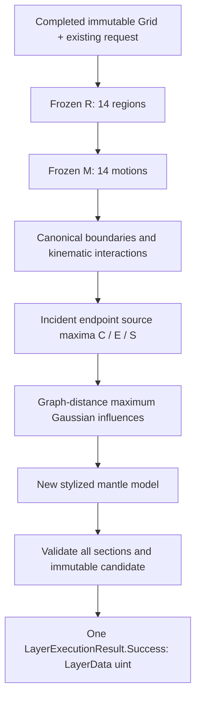

# WG-01-E — Integrated tectonic dynamics proposal

**E1 documentary proposal; not approved implementation or calibration.**
Baseline v0.0.42, 0e98ae43e3bca53f2104a87f7ca6f754d7fa0645, world-tectonics.
Current production remains schema 1/features 7; Influence and mantle are absent.
GATE-01 remains partially open (N01 owner-declared PASS; N02–N17 PENDING).
E1 neither closes that gate nor formally accepts Layer 01.

## One transaction within the existing stage

The repository's real enum is **GenerationStage**, not WorldGenerationStage.
Keep its eight identities/order and WG-CORE unchanged. Future integration stays
inside the existing TectonicPlatesLayer.Execute call:

Each failure discards the private attempt or returns Failed; CORE alone marks
Failed/Completed, publishes, retries and applies its per-context exclusive lease.
No intermediate plates-only/influence-only result is published by this future
integrated operation. Grid and historical immutable views remain intact on
failure/rebuild. Final candidate validation is not CORE FinalizeWorld, which
still requires all eight completed stages and is outside this increment.

Private components may prepare sources, propagate influences, build mantle
fields and validate/encode. They receive Grid/immutable prerequisite values,
not context mutators, State, Saves, surfaces or downstream layer results. No
second coordinator, public RunInfluence/RunMantle, extra stage or progress table.
GenerationProgress remains the only authoritative stage state. Private timings
do not mean additional user-executable stages.

## Deformation sources and propagation

Use **stored approved M boundary components**. For each endpoint v and channel c,
a[v,c]=max over incident boundary amplitudes: Convergence, Divergence, Shear.
Do not sum dense interfaces, filter by crust or make plate borders barriers.
Sources can coexist in different channels at the same cell.

Primary candidate:

    I[x,c] = max over active source cells v of a[v,c] * exp(-(d(v,x)/R)^2)

Here d is unweighted shortest distance from actual Grid neighbor queries,
including the seam and excluding polar wrap; only d<=K contributes. Recommend
the historical integer-shell policy K=min(N-1,ceil(R*cutoff)), with comparison
before narrowing casts to avoid overflow. No unreachable source contributes.
The uint nearest-boundary distance is separate: multi-source BFS from **all**
boundary endpoints, not an amplitude-weighted or channel-specific distance.

Candidate radius policy is R=float(max(Rmin,rho*min(columns,rows))), then use
that **stored canonical float promoted to double**. Cutoff is likewise stored
before use. Rmin, rho and cutoff values require owner calibration in E2;
historical 1/.02/3 are comparison references, not new approved defaults.

Recommend precomputing float(exp(-(d/R)^2)) and float source multiplication
before maximum, matching the historical operation shape. This is a proposed
new Influence numeric revision, not a change to R/M or a claim that historical
world buffers match a new 14-plate field. Canonicalize zero, reject nonfinite or
negative inputs/results. E2 must freeze exact expression order, radius policy,
cutoff shell, revisions, range budgets and full-field vectors before publication.
No per-map output normalization or sum replaces a maximum.

### Cost and optimization comparison

With S active source cells and K cutoff steps, visits are bounded by
S*min(N,1+3K(K+1)); polar clipping and cylindrical identification can only reduce
this planar ball bound. Worst case is O(S*(N+E)); queue/stamps/distances reuse
O(N) scratch. Fused channels avoid three separate BFS traversals. No per-source
world allocation or persistent neighbor cache.

The following **analytical examples**, not execution measurements or approved
parameters, use historical rho=.02, Rmin=1, cutoff=3 and accepted seed-zero R
boundary counts. S<=min(N,2B), which may overcount shared/inactive endpoints.

| Size | N | R / K | Ball bound | Seed-zero S upper bound | Visit upper bound |
| --- | ---: | --- | ---: | ---: | ---: |
| Small | 20,000 | 2 / 6 | 127 | 3,740 | 474,980 |
| Medium | 45,000 | 3 / 9 | 271 | 5,636 | 1,527,356 |
| Large | 80,000 | 4 / 12 | 469 | 7,888 | 3,699,472 |

Large with S=N would allow 37,520,000 visits under those example parameters,
up to six neighbor probes/visit. Larger radii can make this far more expensive;
no extrapolated runtime, hardware-independent threshold or fake benchmark.

| Approach | Semantics | Decision |
| --- | --- | --- |
| Stamped bounded BFS, shared channels and cached attenuation table | Same candidate graph maximum; deterministic source order | Recommended reference; benchmark all sizes/seeds |
| Skip all-zero sources; group incident edges into endpoint maxima | Same result, less duplicate work | Safe structural optimization |
| Pruning / parallel blocks | Must prove every omitted contribution cannot change any channel; private block arrays can add O(workers*N) memory | Require proof, oracle and measurement; no drop merely because a frontier cell did not improve |
| One nearest-source BFS or constant-cost priority wavefront | Can lose a stronger farther source; log amplitude plus squared graph distance is not an ordinary additive edge cost | Different model unless equivalence is proved; explicit approval required |
| Euclidean distance transform, separable blur, sum or nearest-distance attenuation | Changes metric/envelope or density dependence | Alternative model, not a transparent optimization |

## New mantle alternatives

Neither alternative is a geophysical solver or historical implementation.
Both must use only Grid, request, approved R/M and new influences, never
Landmasses/Elevation. Neither feeds back into M directions/speeds or plate IDs.

### A — Bounded multiscale graph potential (recommended for calibration)

Use accepted flat-top center coordinates and period/height to sample two smooth
X-periodic/open-Y scalar fields Nb,Nr in [-1,1], broad and regional. The existing
pure periodic-noise sampler may be reused without changing its R uses or random
draws. Map center X/PeriodWidth and Y/MapHeight into that sampler's coordinate
domain; do not treat offset columns as physical X. Select new frequencies/seeds
independently and account for its octaves when checking aliasing at Small.
Respect the sampler's integer-lattice and frequency <= int.MaxValue/4 limits.
Positive integer frequencies and broad<regional
are structural constraints; values are not selected in E1.

Proposed bounded potential at a cell:

    z = (Extension - Compression) / (Vref + Extension + Compression)
    phi = float((wt*z + wb*Nb + wr*Nr) / (wt+wb+wr))

Vref>0 has diagnostic cm/year units; nonnegative weights have positive total.
All are pending E3 calibration. Canonical published phi lies in [-1,1]; it is a
dimensionless potential, **not temperature or pressure**. Noise allows intraplate
anomalies. Boundary coupling tends to favor divergent-source highs and
convergent-source lows but does not guarantee each local boundary's vertical sign
once other sources/scales coexist; controlled single-source fixtures are needed.

On each real Grid edge i<j derive f=double(phi[i])-double(phi[j]) and the accepted
periodic unit normal n(i,j). Accumulate paired contributions in fixed edge order:

    W[i] += f;       W[j] -= f
    U[i] += f*n.X;   U[j] += f*n.X
    V[i] += f*n.Y;   V[j] += f*n.Y

Use double scratch, then canonical float outputs. f is antisymmetric; W is net
outflow from the horizontal layer, interpreted as compensating **upwelling**
when positive and downwelling when negative. U/V are centered directional flux
proxies, not exact per-cell physical velocities. Up=max(0,W), Down=max(0,-W).
No external polar edge means no fictitious polar flux; the seam uses real edges.
Pairwise cancellation gives qualitative closed circulation before floating-point
roundoff. Post-store global balance needs an explicitly derived rounding budget,
not an arbitrary geology epsilon or a claim of exact fluid mass conservation.

This visits O(N+E) after O(N) fixed-cost noise/forcing evaluation. Phi enables
reconstruction of authoritative edge fluxes; cached U/V/W serve O(1) consumers.
With |phi|<=1 and maximum degree six, ideal scalar/component bounds follow from
six differences of magnitude <=2; these derived bounds are not cm/year limits.
E3 must freeze rounding, canonical pair order, normal reuse, recomputation
checks and the error budget before implementation acceptance.

### B — Boundary-forced graph Poisson circulation

Construct broad/regional plus boundary vertical forcing, balance its graph-wide
mean, then solve an equally weighted Neumann graph Laplacian for potential with
a fixed gauge. Edge flux follows potential differences. This gives more direct
control over prescribed up/down regions but adds a singular-mode constraint,
deterministic solver/reduction order, residual/rounding policy, stopping criteria
and convergence failure handling. Cost is O(iterations*(N+E)), several O(N)
double work arrays; no acceptable iteration count/tolerance is assumed.

It is an alternative model requiring explicit contract/numeric review. No solver
is introduced by E1. Recommend A for its bounded direct construction, clear
topological pairing and measurable cost; B remains available if the owner wants
stronger forcing constraints and accepts calibration/solver complexity.

## Determinism and approval boundaries

Preserve exactly the current three input RNG draws for partition/noise/motion.
Influence needs no entropy. Proposed mantle domain seed:
Construct a fresh DeterministicStageRandom seeded by
DeterministicStageRandom.DeriveSeed(request.Seed,GenerationStage.Tectonics)
XOR the little-endian eight ASCII bytes "WG01MNT1". This is a **proposed
seed-policy revision 1**, not a fourth stage draw. Use that instance's first
two NextUInt64 draws for broad then regional noise. No System.Random,
clock, public tuning setting or WorldType-dependent branch. Freeze E3 vectors
before enabling the profile; separate revisions must identify changes.

[e-contracts.md](e-contracts.md) recommends schema 2; this does not supersede the
approved/current schema 1. All new profile values and signatures require review.
E2/E3 builders remain internal/headless until E4 explicitly enables the complete
atomic result. No partial dynamics UI modes or fake mantle zeros in production.

## Future consumers and Laboratory

| Consumer | Inputs it may use | What remains outside Layer 01 |
| --- | --- | --- |
| Layer 02 Landmasses | Ownership, contacts, C/E/S context, mantle proxies | Own land/ocean/crust model; no assumption that a whole plate is continental/oceanic |
| Layer 03 Elevation | Later surface/crust plus deformation and mantle proxies | Physical meters, uplift/subsidence response and calibration |
| Layer 04 Landforms | Contacts plus later crust/elevation and proxies | Cordilleras, rifts, ridges, trenches, faults and their classification |

Forward-only dependencies remain Grid→Tectonics→later stages; later crust can
classify an old contact without mutating/rebuilding Layer 01. No reverse reads.

Future Game-only views: Plates, Compression, Extension, Shear, Convection
(signed W/up/down), and optional Mantle Flow arrows. They all read the same
completed publication. A view switch never calls generation, changes selection,
resets the camera or hides Grid. Keep one EvolveWindow, existing navigation and
unavailable INICIAR. Old buffers expose only their real features, not zero-filled
new maps. Legends distinguish cm/year-equivalent influence from dimensionless
mantle proxies; no per-map renormalization of Engine values inside a renderer.
No view or geological structure is implemented in E1.
