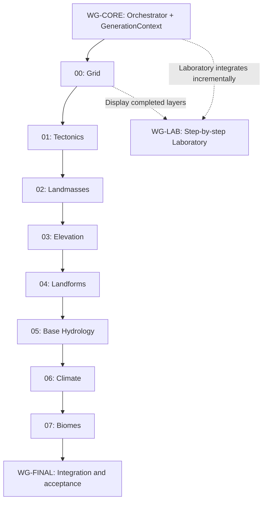

# Evolve — World Generation: General Roadmap

**Repository:** `fgabo404/Evolve`  
**Integration branch:** `world`  
**Status:** PLANNING — approved preliminary architecture; implementation stages not yet authorized  
**Source of truth:** [World Generation Architecture](../../WORLD_GENERATION_ARCHITECTURE.md)

## Goal

Build one reusable, reproducible hex-world generator with tectonics-driven geography, step-by-step Laboratory execution and a complete result suitable for the single active game state.

This roadmap is deliberately **high-level**. Detailed scope, algorithms, acceptance criteria and implementation increments will be agreed in each layer's own `roadmap.md` before that layer is developed.

## Planned delivery sequence

| Stage | Workstream | Planned branch | Main scope |
| --- | --- | --- | --- |
| [WG-CORE](core-architecture.md) | Core | `world-core` | **Architecture approved; implementation pending.** Orchestrator, GenerationContext, stage contract, strict progression and invalidation |
| [WG-00](layers/grid/roadmap.md) | Hex Grid | `world-grid` | Define a continuous east/west hex map with polar north/south limits, three configurable sizes and a proposed 2:1 equirectangular geographic representation. |
| [WG-01](layers/tectonics/roadmap.md) | Tectonic Plates | `world-tectonics` | Generate geologically useful tectonic plates and convergent/divergent/transform boundary relationships. |
| [WG-02](layers/landmasses/roadmap.md) | Landmasses | `world-landmasses` | Support Pangea, 2–4 continents, archipelagos and real-Earth geography with plate-informed land configuration. |
| [WG-03](layers/elevation/roadmap.md) | Elevation | `world-elevation` | Build plausible terrain and ocean-floor heights influenced by plate boundaries and landmasses. |
| [WG-04](layers/landforms/roadmap.md) | Terrestrial Landforms | `world-landforms` | Identify coherent geographical features from existing relief instead of arbitrarily scattering labels. |
| [WG-05](layers/hydrology/roadmap.md) | Base Hydrology | `world-hydrology` | Model terrain-dependent drainage without presupposing final climate-based river discharge. |
| [WG-06](layers/climate/roadmap.md) | Climate | `world-climate` | Derive plausible climate distributions from geography, altitude, maritime influence and atmospheric factors. |
| [WG-07](layers/biomes/roadmap.md) | Biomes | `world-biomes` | Classify biomes as consequences of environmental conditions and approved biome rules. |
| [WG-LAB](../../game/laboratory/readme.md) | Laboratory integration | `world-laboratory` | Expose step-by-step execution and visualization in the existing EvolveWindow, without a second generator |
| [WG-FINAL](../../tests/worldgen/readme.md) | Integration and acceptance | `world` | Verify entire world pipeline, visual inspection, performance and owner acceptance |

**Sequencing:** approve and implement the common orchestration/context contract first; build layers 00 through 07 in dependency order. Laboratory functionality is an **incremental, cross-cutting workstream**, initially able to show grid results and expanded as each layer is delivered; it must never get its own generation algorithms. Final integration follows completion of the pipeline.

## Layer roadmap and branch policy

- Every layer owns its internal `layers/<layer>/roadmap.md`; its **detailed plan must be designed and approved separately**.
- Every layer is developed in a **dedicated Git branch** from the current `world` integration baseline, after preceding approved work has been integrated.
- The names above are **proposals, not branches created by this documentation task**. They use `world-grid`, etc., rather than `world/grid`: a ref named `world` already exists, so a Git branch name beginning with `world/` would conflict.
- The cross-cutting core and Laboratory workstreams also have proposed dedicated branches. Their implementation order and increments need approval.
- Only owner-approved work may be committed; accepted work is then integrated into `world` through an explicitly approved integration action. `develop` remains unaffected until separately authorized.
- The general roadmap documents progress; no layer advances before its immediate predecessor is valid and successfully completed in the **same** generation context.

## Acceptance gates (to be detailed per workstream)

1. Approve architecture, contracts, constraints and acceptance criteria for the proposed increment.
2. Implement on its authorized branch; keep `definitions/`, `engine/`, `state/` and `game/` responsibilities separated.
3. Test the stage and its orchestration prerequisites, including deterministic results and downstream invalidation where relevant.
4. Independently review and obtain project-owner acceptance before integrating.
5. Update the applicable roadmap and increment root `VERSION` on each authorized commit.

## Scope exclusions

No C# implementation, new projects, standalone window, additional generator, geographic algorithms or new stage-specific requirements are authorized merely by creating this roadmap. Unresolved technical decisions remain in the [architecture document](../../WORLD_GENERATION_ARCHITECTURE.md).

**Current status:** WG-CORE architectural design approved and documented in [core-architecture.md](core-architecture.md). Its implementation and all other development stages remain pending.
